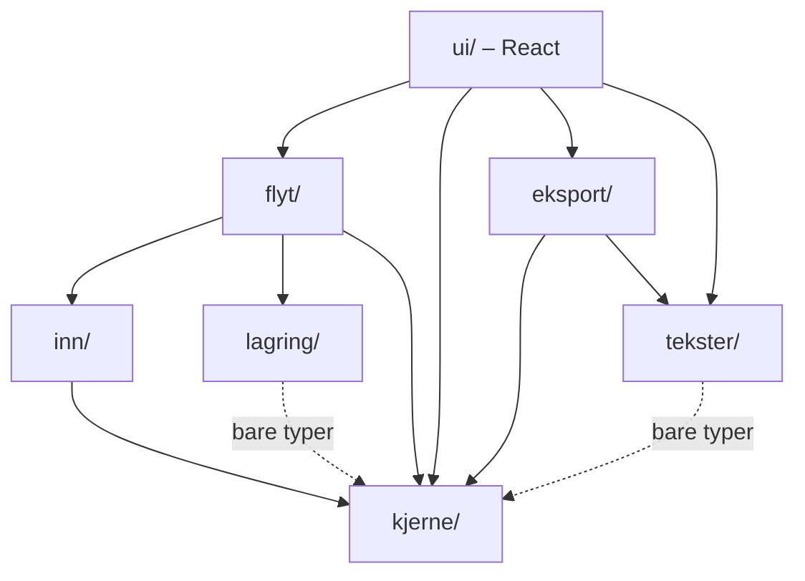
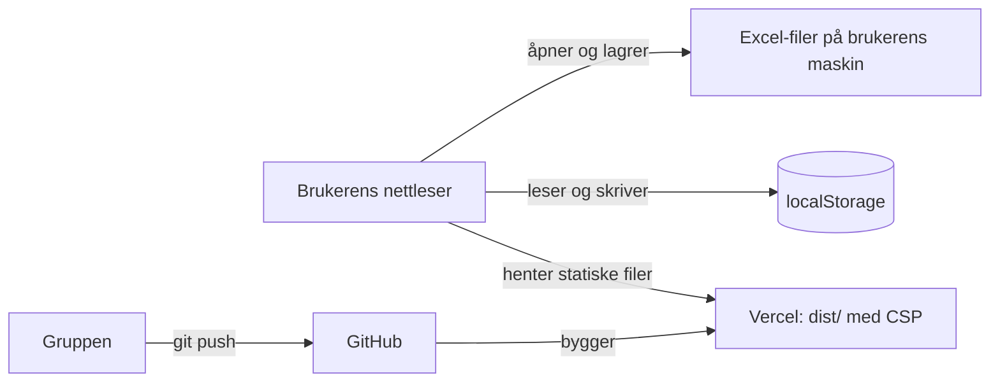

# Architecture Spine – COSI - MRP v1

Carmen Kolstads individuelle arkitektur, utarbeidet i BMAD Coaching-modus 2026-11-15 og 2026-11-21. Beslutningene er tatt av Carmen; begrunnelsene står i `.memlog.md`. Arkitekturen er **ikke godkjent av hele gruppen G23**; spørsmålene som krever gruppebeslutning står under «Åpne gruppeavklaringer» nederst. Til gruppeavklaring nr. 1 er avgjort, binder spinen bare Carmens egne stories, og reglene for arbeidsflyt i AD-8 og AD-9 (pull request, koordinator, grønne kontroller før fletting) er Carmens forslag til gruppeavklaring nr. 6 og nr. 10. Bindende kravgrunnlag er origin/main på `8b3fba0`. UX-prototyper og UX-research er rådgivende og overstyrer ikke PRD-en eller denne spinen.

## Design Paradigm

**Funksjonell kjerne med tynt skall.** All MRP-logikk, alle domeneregler og alle dataformer ligger i en ren kjerne uten sideeffekter. Skallet rundt gjør det som berører omverdenen: lese filer, lagre i nettleseren, skrive Excel, vise brukergrensesnitt. Et koordineringslag (`flyt/`) binder skallet sammen uten å være avhengig av React.

| Lag | Mappe | Ansvar | Kan bruke |
| --- | --- | --- | --- |
| Kjerne | `src/kjerne/` | Alle delte dataformer, all validering (FR-2-feil og FR-3), MRP, eksepsjoner, bestillingsforslag, kapasitet, sammenligning, forklaringer, serialisering og tolkning av lagret kjøring, uke↔indeks | ingenting |
| Innlesing | `src/inn/` | Excel-kontrakten (ark, kolonner, celleplasser), Excel → Rådata med kildeinformasjon, avvisning av fil (FR-1, NFR-9), finne ark og kolonner (FR-2) | `kjerne` |
| Lagring | `src/lagring/` | Tekst inn og ut av localStorage bak asynkront grensesnitt, innstillinger | `kjerne` (bare typer) |
| Eksport | `src/eksport/` | Kjøring + Sammenligning → `.xlsx`-bytes og filnavn | `kjerne`, `tekster` |
| Tekster | `src/tekster/` | All synlig norsk tekst, tall- og datoformatering, filnavn for eksport | `kjerne` (bare typer) |
| Flyt | `src/flyt/` | Kjøringsflyten, lagrede kjøringer, innstillinger, komposisjonsrot (`flyt/oppsett.ts`) | `inn`, `lagring`, `kjerne` |
| Brukergrensesnitt | `src/ui/` | React, hash-ruting, felles tilstand, visninger, feilgrense | `flyt`, `kjerne`, `eksport`, `tekster` |

## Invariants & Rules



Pilene er de eneste tillatte importene mellom lagene. Stiplede piler tillater bare `import type`. `kjerne/` importerer ingenting fra andre lag. Arkitekturtesten i AD-8 håndhever grafen.

### AD-1 — Vite + React + TypeScript med minimalt oppsett

- **Binds (gjelder):** all kode og alle avhengigheter.
- **Prevents (hindrer):** at fire utviklere velger rammeverk, byggeverktøy eller hjelpebibliotek som ikke kan settes sammen; unødvendig læringskurve.
- **Rule (regel):** Prosjektet starter fra `create-vite`-malen `react-ts`. Tillatte avhengigheter er malens (react, react-dom, @vitejs/plugin-react, typescript, vite, oxlint, @types/*), pluss `vitest` og `@playwright/test` (AD-8) og `read-excel-file` og `write-excel-file` (AD-4). Alle versjoner låses eksakt (uten `^` og `~`), og arkitekturtesten kontrollerer listen. Ingen ruter-, tilstands-, UI-komponent-, CSS-, formaterings- eller oversettelsesbibliotek; shadcn/ui og andre krever en ny, begrunnet AD. TypeScript kjøres med `strict`, `noUncheckedIndexedAccess` og `verbatimModuleSyntax`. UX-prototypene er referanse for utseende, tekst og flyt – koden deres flyttes ikke inn i appen.

### AD-2 — Funksjonell kjerne med tynt skall og delt validering

- **Binds (gjelder):** all kode under `src/`; FR-1–FR-4, NFR-1, NFR-9, NFR-11.
- **Prevents (hindrer):** MRP-regler eller validering i React-komponenter eller Excel-kode; at samme regel finnes to steder; at NFR-1 bare er en intensjon.
- **Rule (regel):** Lagene og avhengighetsgrafen over er bindende. `kjerne/` bruker ingen DOM-, nettleser-, Excel- eller klokke-API, er deterministisk (FR-8) og har egen `tsconfig` uten DOM. **`inn/`** sjekker endelsen `.xlsx` (uten hensyn til store og små bokstaver) før innholdet tolkes, avviser filer over 10 MB og innlesinger som tar mer enn 15 sekunder, og gjør alle bibliotekets feil om til avvisninger (FR-1, NFR-9). Testfilen på 1000 rader og e2e-filen som utløser Web Worker, skal ligge godt under begge grensene. **`inn/` eier Excel-kontrakten** – malens arknavn, kolonnenavn og faste celleplasser (Stykkliste A–H, Planlagte mottak A–C, MPS som i malen, der malkolonne-uke regnes ut fra radnummeret som rad − 1, så kolonne A bare er hjelpetekst) – og ingen andre lag importerer den. Den sammenligner overskriftene nøyaktig etter trimming. Den leser hele det brukte området (stopper ikke ved første tomme rad eller ved rad 1001), tolker ingen verdier – bortsett fra å gjøre nivå og varenummer om til tekst (NFR-11) – og leverer Rådata med stabile, interne ASCII-feltnøkler (AD-3). Kildeinformasjonen (arknavn, kolonnenavn, kolonnebokstav) står én gang per ark i Rådata, ikke i hver rad. For et ark eller en kolonne som mangler, oppgir `inn/` det forventede navnet og den forventede plasseringen (for eksempel «Ledetid (uker)» i H1). Rådata skiller manglende kolonne fra tom kolonne. Bare malens kolonner leses; Veiledning, Veien videre, Kontroll-kolonnen og hjelpekolonnene leses ikke (FR-2). **`inn/` lager aldri valideringsfeil.** **`kjerne/`** lager alle valideringsfeil i én funksjon – strukturfeil fra FR-2 og alle regler i FR-3 – ferdig sortert etter AD-7, og kopierer kildeinformasjonen fra Rådata inn i plasseringen, uten å kjenne Excel-malen. Et fremtidig nettskjema kan levere Rådata med sine egne feltnavn til samme kjerne. En avhengighetstabell i `kjerne/` sier hvilke kontroller som hoppes over når et ark eller en kolonne mangler (FR-2, V-F06). `kjerne/` finner selv hvor stykklisten slutter (siste rad med verdi i en av malens kolonner), så en tom rad midt i gir feil (V-S01) – en tolkning framfor addendumets forslag om å stoppe ved første tomme rad (gruppeavklaring nr. 11). MPS med flere enn 12 utfylte uker gir horisontfeil (FR-3). **Trimming og tall lagret som tekst (midlertidig regel, Carmen 2026-11-21, må bekreftes av gruppen før valideringen implementeres):** `inn/` trimmer mellomrom før og etter tekstverdier (bibliotekets standard) og gjør ingen numerisk tolkning. `kjerne/` tolker en verdi i et heltallsfelt slik: et tall som er et heltall, godtas; en tekst som etter trimming består av et valgfritt minustegn og bare sifre (`^-?[0-9]+$`), godtas som det heltallet (`"7"` → 7, `"-5"` → −5, `"007"` → 7); alt annet gir valideringsfeil – desimaltall (som tall eller tekst, `30.5`, `"30,5"`), ord (`"tretti"`), tusenskilletegn (`"1 000"`, `"1.000"`), plusstegn og andre uklare formater (`"ca. 40"`, `"+7"`). Etter tolkningen kontrollerer `kjerne/` grensene og de andre reglene i FR-3 som vanlig, så `"-5"` i MPS gir feilen «heltall ≥ 0». Varenummer tolkes aldri som tall og beholdes som tekst, så ledende nuller i en tekstcelle («000123») blir stående. Reglene har egne enhetstester med Rådata i `kjerne/`; de felles testdataene endres ikke.

### AD-3 — Delte dataformer eies av kjerne/, og bare et utdrag lagres

- **Binds (gjelder):** `kjerne/`, `lagring/`, `flyt/`, `eksport/`, `tekster/`, `ui/`; FR-6, FR-9–FR-23, FR-28–FR-34, NFR-10.
- **Prevents (hindrer):** at moduler former de samme dataene ulikt; at regler som art, forfalt mengde eller sammenligning lages flere steder; at Excel-filen eller grunnlagsdata lagres; at lagringsformatet bindes til hele datamodellen.
- **Rule (regel):** Alle delte typer defineres i `src/kjerne/typer.ts` (AD-9) og brukes uendret av de andre lagene:
  - **Rådata:** per ark (`stykkliste`, `mps`, `planlagteMottak`) enten «mangler» med forventet arknavn, eller arknavnet, en feltkatalog (feltnøkkel → kolonnenavn og kolonnebokstav, eller «mangler» med forventet navn og forventet celle) og rader med Excel-radnummer (for MPS også malkolonne-uke) og rå verdier per feltnøkkel. Feltnøklene er ASCII (`niva`, `varenummer`, `beskrivelse`, `antall`, `type`, `lagerbeholdning`, `sikkerhetslager`, `ledetidUker`, `antallFerdigprodukter`, `uke`).
  - **Grunnlagsdata:** ferdigprodukt, horisont, prognostiserte behov per uke, deler i stykklistens rekkefølge ved første forekomst (med nivå ved første forekomst for visning, lavnivåkode for beregning, overordnede deler med antall, type, lager, SS, ledetid), og planlagte mottak summert per varenummer og uke (FR-6). FR-12 og FR-29 behandler summen som ett mottak; kontrolleres mot fasit 04.
  - **Kjøring** (bare i minnet, bare når bestillingsplanen er valgt): Grunnlagsdata, tidspunkt, resultattabell per del med de seks radene i FR-14, et sporingsfelt per del og uke (beholdning forrige uke, disponibel før og etter fremskynding, fremskyndede mottak, forfalt mengde, bidrag fra hver overordnet del), eksepsjoner, kritiske deler og bestillingsforslag. Bestillingsforslag har art (innkjøp eller produksjonsordre) og forfalt mengde, lages i `kjerne/` og sorteres etter frigivelsesuke og så stykklistens rekkefølge; `ui/` og `eksport/` utleder aldri art. `beregnBestillingsplan(grunnlag, tidspunkt)` lager kjøringen og `beregnKapasitet(grunnlag)` kapasiteten; `flyt/` kaller dem etter valget i FR-30 og gir tidspunktet.
  - **Eksepsjon:** type (de fem i PRD §4.3), varenummer, `uke: number | null` (`null` = hele delen), og en lukket parametertype per eksepsjonstype som er selvbærende: navn og varenummer for berørte og overordnede deler, `leveranseTilKunde`, hvor et mottak må fremskyndes (`leverandor` eller `egenProduksjon`), stien med ledetider (FR-9), og tallene før og etter fremskynding (FR-10–FR-12). Teksten kan lages fra eksepsjonen alene. Eksepsjonslisten sorteres i `kjerne/` som i fasit 01–05: stykklistens rekkefølge, så uke (`null` først), så typen i rekkefølgen i PRD §4.3 (Ledetid overskrider horisont, Bestilling forsinket, Bruk av sikkerhetslager, Mottak forsinket, Kanseller mottak), så mottaksuken.
  - **Forklaring:** `forklar(kjoring, celleId)` er en ren funksjon i `kjerne/` som bare leser Kjøring og returnerer strukturerte data (FR-18): radtypen og uken, regelen som ble brukt (som kode), tallene som inngår (navn og verdi), bidraget fra hver overordnet del, fremskyndede mottak og eksepsjonene i cellen. `celleId` er `{ varenummer, rad, uke | null }`. Ingen andre lag regner MRP på nytt.
  - **Kapasitet:** to rader per uke (fra lager og med planlagte mottak), begrensende deler per uke og rad med en liste over årsaker (lager, ledetid – i den rekkefølgen, begge når begge gjelder), og en tabell per del med lager, SS, ledig beholdning, ledetid og mottak per uke (FR-31–FR-34), i stykklistens rekkefølge. Lages, lagres ikke og eksporteres ikke.
  - **LagretKjøring** – det eneste som lagres: versjon, ferdigprodukt (varenummer på nivå 0 og navn), tidspunkt, horisont, deler (varenummer, beskrivelse) i stykklistens rekkefølge, bestillingsforslag (varenummer, frigivelsesuke, mengde) og eksepsjoner med parametere. Parametertypene er en del av versjonen.
  - **Sammenligning:** en ferdig sortert liste av linjer (hva: bestillingsforslag, eksepsjon eller del; endring; varenummer; uke; før; etter; eksepsjon), laget bare i `kjerne/` fra to LagretKjøring. Rekkefølgen er som i fasit 03: bestillingsforslag, så eksepsjoner, så deler, hver gruppe i stykklistens rekkefølge (fjernede deler etter sin gamle plass) og så etter uke. Eksepsjoner sammenlignes som multimengde per nøkkel varenummer + uke + type, så to like eksepsjoner i samme celle ikke forsvinner; innenfor en nøkkel pares de i den sorterte rekkefølgen, og de siste uten partner blir «Ny» eller «Borte» med sin egen melding (gruppeavklaring nr. 11). Endringskodene er `nytt`, `endretMengde` og `fjernet` for bestillingsforslag, `ny` og `borte` for eksepsjoner, og `ny` og `fjernet` for deler; en dellinje har varenummer og beskrivelse og ingen uke eller tall.
  
  Rekkefølgen er alltid: les forrige → sammenlign → lagre ny. Det lagres bare etter en vellykket kjøring der bestillingsplanen er valgt – aldri ved valideringsfeil (FR-4) eller når bare kapasiteten er valgt (FR-30). Eksport (FR-22, FR-23) bruker alltid Kjøring og Sammenligning i minnet, aldri det lagrede utdraget. Serialisering (`tilLagringstekst`) og tolkning (`tolkLagret`) ligger i `kjerne/`; en test sender en Kjøring gjennom utdrag, JSON og tolkning og krever null forskjeller.

### AD-4 — read-excel-file og write-excel-file

- **Binds (gjelder):** `inn/`, `eksport/`, testkode; FR-1, FR-2, FR-22, FR-23, NFR-9, NFR-11.
- **Prevents (hindrer):** flere Excel-bibliotek; at et bibliotek tolker eller validerer verdier; at Excel-API lekker inn i `kjerne/` eller `ui/`.
- **Rule (regel):** `read-excel-file` importeres bare i `inn/` (fra `read-excel-file/browser`) og i testkode (fra `read-excel-file/node`) for å lese fasitfiler; `write-excel-file` bare i `eksport/`. Filer leses uten bibliotekets skjema (`schema`/`parseSheetData` brukes ikke). Alle `InvalidInputError`-koder (`INPUT_TYPE_NOT_SUPPORTED`, `FILE_NOT_SUPPORTED`, `XLS_FILE_NOT_SUPPORTED`, `INVALID_ZIP`, `NO_DATA`) og feilklassene `InvalidSpreadsheetError` og `SheetNotFoundError` gjøres om til avvisninger i `inn/`; ukjente feil blir uventet feil. Eksporten har arkene Kjøring (ferdigproduktets navn, horisont, tidspunkt), Resultattabell (kolonnene Varenummer, Rad, Uke 1 … Uke H som fasitarket Fasittabell), Bestillingsforslag og Eksepsjoner (samme kolonner som fasitarkene, uke «–» for hele delen) og, når en sammenligning finnes, Sammenligning (kolonnene i fasit 03, med overskriftsraden i rad 1 uten tittelrader; fasittesten finner linjene i fasit 03 under overskriftsraden for riktig retning). Tall skrives som tall, aldri som formatert tekst; forfalt mengde 0 og andre tomme verdier i fasiten skrives som tomme celler. `eksport/` er asynkron og returnerer `Promise<Utfall<{ bytes, filnavn }>>`. Løsningen er ikke godkjent før disse testene er bestått: kjøring i nettleseren (Chrome, Edge, Firefox), testeksempel 01 og 02 åpnet og lagret i Excel for Mac og Windows gir samme resultat, og eksportfilen åpnes i ekte Excel uten feilmelding. Reserve: SheetJS CE fra cdn.sheetjs.com, versjon 0.20.3 (nyeste per 2026-11-21) og aldri eldre enn 0.20.2 (CVE-2024-22363), og aldri npm-versjonen 0.18.5 (CVE-2023-30533); et bytte endrer bare `inn/` og `eksport/`.

### AD-5 — localStorage bak et asynkront grensesnitt

- **Binds (gjelder):** `lagring/`, `flyt/`; FR-19, FR-21, NFR-10.
- **Prevents (hindrer):** direkte bruk av localStorage utenfor ett sted; at et bytte til IndexedDB sprer seg i appen; at lagringsfeil stopper appen; dobbel serialisering; at data om et slettet ferdigprodukt blir liggende.
- **Rule (regel):** Bare `lagring/nettleser.ts` rører `window.localStorage` (inne i `try/catch`, fordi tilgangen selv kan kaste). `lagring/` tar og gir bare tekst: `lagre(varenummer, tekst)`, `hent(varenummer)`, `list()` og `slett(varenummer)`, alle som `Promise<Utfall>` (se konvensjonen «Utfall») uten å kaste; feilkodene er `blokkert`, `full` og `ukjentFeil`, og `ulesbar` settes av tolkningen i `kjerne/`. Serialisering og tolkning ligger i `kjerne/` (AD-3) og kalles av `flyt/`. Lagringsobjektet sendes inn som parameter, så alt kan testes i Node med en minnebasert erstatning som også kan simulere blokkert og full lagring. Én nøkkel per ferdigprodukt: `cosi-mrp:kjoring:<varenummer>`; ingen separat indeks – listen lages fra nøklene med prefikset. Ulesbare poster brukes ikke i sammenligning, vises som «kan ikke leses» med Slett, og overskrives ved neste vellykkede lagring. Feiler lagringen, står forrige lagrede kjøring urørt og brukeren får beskjed med tidspunktet for den; appen sletter aldri andre ferdigprodukters kjøringer for å få plass. Etter sletting leses nøkkelen på nytt for å bekrefte at den er borte. Innstillinger lagres gjennom `lagring/` under et eget prefiks og inneholder aldri varenummer eller andre produktdata. Flere samtidige faner støttes ikke i MVP; siste lagring vinner.

### AD-6 — Hash-ruting, felles og lokal tilstand, og kjøringsflyt utenfor React

- **Binds (gjelder):** `ui/`, `flyt/`; FR-4, FR-16–FR-18, FR-30, FR-34, NFR-5, NFR-9.
- **Prevents (hindrer):** at hver visning lager sin egen kopi av kjøringen; at kjøringsflyten bare kan testes gjennom React; serverruting; at et valg om bare kapasitet likevel lagrer; unødvendig omtegning av store tabeller.
- **Rule (regel):** Navigasjon med hash-ruting skrevet selv: hver visning er én `#`-adresse i ASCII, og rutetabellen eies av `ui/` og kan endres etter gruppens UX-vedtak uten arkitekturendring. `flyt/` er ren TypeScript uten React. `kjorFil({ bytes, filnavn, valg, lagring, naa })`, der `naa` er en funksjon som gir tidspunktet som ISO 8601-streng, tar valget fra FR-30 (`{ bestillingsplan, kapasitet }`, minst én sann), kjører les → valider → beregn → (bare når bestillingsplanen er valgt) les forrige → sammenlign → lagre, og returnerer ett `Utfall`: `ok: true` med `verdi` = `{ kjoring | null, sammenligning | null, kapasitet | null, lagringsutfall, meldinger }`, eller `ok: false` med koden `avvist`, `valideringsfeil` (med listen) eller `uventetFeil`. Den kaster aldri ut til `ui/`. Et nytt valg er en ny kjøring gjennom `flyt/`. `flyt/oppsett.ts` er komposisjonsroten: den lager nettleserflyten med `lagring/nettleser.ts` og systemklokken, og `ui/` kaller bare den – `ui/` importerer ikke `inn/` eller `lagring/`. Felles tilstand (React Context + `useReducer`) for gjeldende resultat, beregningsvalg, lagringsutfall og statusmeldinger, fordelt på separate kontekster: resultatdata, status og meldinger, og handlinger. Et vellykket utfall erstatter hele resultatet, også felt som er `null`; ved valideringsfeil eller uventet feil står forrige visning urørt. Tilstand som bare én visning bruker – ukefilter, valgt del og celle, åpent forklaringspanel, utvidede seksjoner, sortering – er lokal i visningen og legges ikke i hashen. Kjøring og Sammenligning er uforanderlige; resultattabellen får dem som props og er memoisert per del, og valgt celle sendes som én `celleId`. `eksport/` fanger egne unntak og returnerer `{ bytes, filnavn }` eller et feilutfall; `ui/` starter nedlastingen. `ui/` har én React-feilgrense rundt visningene som viser en norsk reservemelding og lar brukeren laste opp på nytt; feil i hendelsesbehandlere håndteres som i konvensjonen «Utfall». Visninger som trenger en kjøring, viser en tom tilstand med lenke til Ny kjøring når ingen finnes – også rett etter at siden er lastet på nytt.

### AD-7 — Strukturerte meldinger, synlig tekst bare i tekster/

- **Binds (gjelder):** alle lag; FR-4, FR-9–FR-13, FR-20, FR-22, FR-23, FR-29, NFR-7, NFR-9.
- **Prevents (hindrer):** norsk tekst spredt i beregning og validering; at engelsk krever endring av beregningen; tester som avhenger av ordlyd; tomme eller tekniske feilmeldinger til brukeren.
- **Rule (regel):** `kjerne/`, `inn/`, `lagring/`, `flyt/` og `eksport/` returnerer strukturerte meldinger – kode eller type + parametere – aldri ferdig tekst. All synlig tekst, inkludert eksportens arknavn, overskrifter og filnavn, lages i `tekster/` (`tekster/no.ts` i v1). Filnavnet på eksporten har ferdigproduktets navn med æøå beholdt og lokal dato; tegnene `\ / : * ? " < > |` byttes ut. `tekster/` gjengir en eksepsjon fra eksepsjonen alene, uten tilgang til Kjøring. Alle valideringsfeil har én struktur definert i `kjerne/`: plassering, felt, årsakskode og parametere. `Plassering` har arknøkkelen (for sortering) og kildeinformasjonen kopiert fra Rådata – arknavn og eventuelt feltnavn – og er en diskriminert union: bare ark, ark + rad, ark + rad + kolonne (celle), eller ark + uke (malkolonne-uke i MPS). Gjelder en feil flere rader (FR-3, V-S22), står den første i plasseringen og de andre i parameterne. `tekster/` gjengir feilen fra plasseringen alene, uten å importere `inn/`. Feilene samles i én liste (FR-4), sortert fast: Stykkliste, MPS, Planlagte mottak, deretter rad eller uke, deretter kolonne. Uventede tekniske feil fanges i `flyt/`, `eksport/` og React-feilgrensen, gir aldri delvis resultat, og tekniske detaljer skrives bare til nettleserkonsollen – aldri sendt ut (NFR-4). `tekster/` har uttømmende typesjekk, så en ny kode uten tekst gir kompileringsfeil; en generell reservetekst brukes bare for ukjente koder fra lagrede data. Testene kontrollerer koder og parametere mot fasit; for hver eksepsjonstype finnes en test som sjekker at gjengitt tekst inneholder alle opplysningene PRD-en krever (FR-13), og en test gjengir alle «Borte»-meldingene i fasit 03 fra et lagret utdrag alene.

### AD-8 — Vitest, Playwright, Node 24 og statisk publisering på Vercel

- **Binds (gjelder):** test- og byggeoppsett, publisering; NFR-2, NFR-3, NFR-4, NFR-5, NFR-6.
- **Prevents (hindrer):** forventede verdier laget av appens egen kode; at testene krever nøkler, nettlesere eller oppsett; at reglene i AD-1–AD-9 bare håndheves av disiplin; at data forlater nettleseren; ulike Node-versjoner i gruppen.
- **Rule (regel):** `npm test` kjører bare Vitest: fasittester for testeksempel 01–05 (resultattabell, eksepsjoner, bestillingsforslag, sammenligning, kapasitet – tidspunkt ignoreres, celler finnes etter posisjon og ikke ordlyd), én test per valideringsfil i `testdata/validering/`, flyt, lagring, eksport og tekster, og en **arkitekturtest** – skrevet som enkel tekstsøking i kildefilene, uten parser, med `verbatimModuleSyntax` på i `tsconfig` så typeimporter alltid skrives `import type` på toppnivå – som kontrollerer alle `import`, `export … from` og `import()` i `src/`, også testfilene der (som i tillegg kan importere `vitest`): importgrafen (med `import type` for stiplede kanter), at `src/kjerne/` ikke bruker `Date.now`, `new Date()`, `Math.random`, `window`, `document` eller `localStorage`, at `localStorage` bare finnes i `lagring/nettleser.ts`, at filnavn under `src/` er ASCII, og at `package.json` bare har tillatte avhengigheter med eksakte versjoner. Videre en test for at malen og testeksempel 01 i `public/` er byte-like filene i `testdata/` (FR-27), og en test for at CSP-en i `vercel.json` og i `vite preview` er like. Fasitene leses direkte fra `testdata/`; `lag_testdata.py` importeres ikke, og appens kode lager aldri forventede verdier. `npm run test:e2e` kjører Playwright mot `vite preview` med CSP-en på: brukerreiser i Chromium og Firefox, Edge der den er installert, blokkert lagring (NFR-10), ny fil uten omlasting (NFR-9), tastatur i forklaringspanelet (FR-18), en stor fil som utløser Web Worker, og null CSP-brudd. NFR-5 måles på hele flyten med en fil på 1000 rader. `npm run lint` kjører oxlint. `npm run build` = TypeScript-kontroll + `vite build` til `dist/`. `npm test`, `npm run lint` og `npm run build` skal være grønne før fletting til `main`. Node 24 (Maintenance LTS, støttet til 2028-04-30; `engines` og `.nvmrc` med nyeste 24.x); `package-lock.json` committes, `npm ci` brukes, og `npm ci` prøves på Windows tidlig fordi flere verktøy har plattformspesifikke binærpakker. README beskriver `npm ci`, `npm test`, `npm run dev` og `npm run test:e2e` (med `npx playwright install chromium firefox`), slik at en person utenfor gruppen kan starte appen og kjøre testene uten hjelp (NFR-3, SM-6). Publisering er statisk på Vercel [ADOPTED – PRD-addendum, besluttet 2026-11-05]: ingen serverfunksjoner (`api/`), ingen ekstern lagring, ingen Analytics eller Speed Insights. CSP: `default-src 'self'; script-src 'self'; style-src 'self'; img-src 'self' data: blob:; worker-src 'self' blob:; connect-src 'self'; object-src 'none'; base-uri 'self'; form-action 'none'; frame-ancestors 'none'`. `worker-src blob:` trengs fordi read-excel-file pakker ut med fflate, som lager Web Worker fra `blob:` for store filoppføringer; uten den henger innlesingen, og tidsgrensen i `inn/` (AD-2) gjør det til en avvisning.

### AD-9 — Felles datakontrakter først, med én koordinator

- **Binds (gjelder):** implementeringsrekkefølgen; `src/kjerne/typer.ts` og ukehjelperne; alle lag som bruker delte typer.
- **Prevents (hindrer):** konkurrerende versjoner av delte typer; at parallelle spor først oppdager inkompatible grensesnitt når de kobles sammen.
- **Rule (regel):** To stories flettes inn i `main` før implementering som bruker delte typer starter. **Story 0** etablerer prosjektoppsettet: malen og avhengighetene i AD-1, Vitest, oxlint, skriptene og arkitekturtesten i AD-8. **Story 1** etablerer datakontraktene i `src/kjerne/typer.ts` – `Radata`, `Grunnlagsdata`, `Kjoring`, `LagretKjoring`, `Valideringsfeil`, `Plassering`, `Eksepsjon`, `Bestillingsforslag`, `Sammenligning`, `Kapasitet`, `Forklaring`, `CelleId`, `Avvisning` og `Utfall` slik AD-3 og AD-7 beskriver dem – grensesnittene mellom lagene (lagringsgrensesnittet i AD-5, signaturen til `kjorFil` i AD-6, eksportfunksjonen i AD-4 og innlesingsfunksjonen i `inn/`) og ukehjelperne med tester. Kontraktene regnes som stabile først når de er kontrollert mot PRD, testdata og fasit: hvert fasitark (Fasittabell, Eksepsjoner, Bestillingsforslag, Sammenligning, Kapasitet) og hver valideringsfil kan uttrykkes i typene, og JSON-rundturen i AD-3 består. Én koordinator, valgt av gruppen, eier `typer.ts`. Endringer i delte typer skjer bare gjennom pull request vurdert av koordinatoren og minst én utvikler som bruker typene. Ingen oppretter egne eller konkurrerende versjoner av delte typer; typer som bare brukes inne i ett lag, er tillatt der. Planlegging og arbeid som ikke avhenger av typene – epics, README, UX, testfilen på 1000 rader – kan pågå mens Story 0 og 1 ferdigstilles. Rekkefølgen etter Story 1: innlesing (`inn/`), validering og MRP-motoren med eksepsjoner (`kjerne/`) prioriteres først; `ui/` kan bygges parallelt mot kontrollerte eksempeldata som følger typene og er hentet fra fasit 01, ikke laget av appens beregning; deretter `flyt/`; så lagring, sammenligning og eksport (trinn 3), produksjonskapasitet (trinn 4) og fast partistørrelse (trinn 5) etter avhengighetene og PRD §7.1. AD-9 fastsetter rekkefølgen, ikke den endelige inndelingen i epics og stories.

## Consistency Conventions

| Concern | Convention |
| --- | --- |
| Domenenavn | Begrepene i ordbanken, på norsk, i kode og dokumenter. Navn i kode for de sentrale typene: `Radata`, `Grunnlagsdata`, `Kjoring`, `LagretKjoring`, `Valideringsfeil`, `Plassering`, `Eksepsjon`, `Bestillingsforslag`, `Sammenligning`, `Kapasitet`, `Utfall`, `Avvisning`. Nye begreper må inn i ordbanken (gruppeavklaring nr. 4): Rådata, Grunnlagsdata i ny betydning, LagretKjøring, Kjøringsflyt, Utfall, Avvisning, Plassering, feltkatalog, horisontuke, malkolonne-uke, ukeverdi, sporingsfelt, art, celleId, komposisjonsrot og koordinator. |
| Identifikatorer og filnavn | Bekreftet av Carmen 2026-11-21. Programkode, filnavn, interne adresser (`#/…`) og interne nøkler er ASCII. Norske domenebegreper beholdes, men æ, ø og å skrives ae, o og a (`Kjoring`, `LagretKjoring`, `lagret-kjoring.ts`, `#/lagrede-kjoringer`, `cosi-mrp:kjoring:<varenummer>`). Typer og React-komponenter i PascalCase, funksjoner og variabler i camelCase, filnavn i kebab-case. All synlig tekst til brukeren er korrekt norsk med æ, ø og å – også filnavnet på eksportfilen. Excel-malens ark- og kolonnenavn (for eksempel `Stykkliste`, `Planlagte mottak`, `Nivå`, `Ledetid (uker)`, `Antall ferdigprodukter`) beholdes nøyaktig som i PRD-en og `testdata/`. |
| Varenummer | Alltid `string`, trimmet. Et tall gjøres om med `String(n)`: tallet 300001 og teksten «300001» er samme varenummer (NFR-11), mens «000123» og 123 er ulike. |
| Nivå | Tekst i Rådata (`"0"`, `".1"`, `"..2"`); tallet `0`, `1` eller `2` i Grunnlagsdata. |
| Uker | Bekreftet av Carmen 2026-11-21, også etter presiseringen fra reviewer gate. Tre slags uker: (1) **horisontuke** 1 til H for resultater – resultattabell, bestillingsforslag og eksepsjonens `uke`; (2) **malkolonne-uke** 1 til 12 for plassering i MPS, uavhengig av H (V-M02, V-M03); (3) **ukeverdi i melding eller parameter**, et heltall som ikke valideres – forfalt uke 0 eller lavere (FR-10), tidligste mottaksuke 1 + L over H, og uken brukeren skrev i Planlagte mottak (V-P02, V-P03). Interne TypeScript-lister per horisontuke har lengde H og er 0-baserte: uke 1 er indeks 0, uke `t` er indeks `t − 1`. Konverteringen skjer bare gjennom felles hjelpefunksjoner i `kjerne/`, som avviser horisontuker utenfor 1 til H og indekser utenfor 0 til H − 1. Testene dekker uke 1, uke H og ugyldige verdier (0, H + 1, negative tall og desimaltall), og V-M02, V-M03, V-P02, V-P03 og meldingen for 300-003 i fasit 01. «Hele delen» er `null`. |
| Mengder | Heltall (`number`). Formatering skjer bare i `tekster/`. Eksporten skriver tall som tall. |
| Tidspunkt | ISO 8601-streng i UTC, satt av `flyt/` fra klokken den får inn. Vises, og brukes i eksportens filnavn, som lokal dato via `tekster/`. |
| Rekkefølge | Deler i stykklistens rekkefølge, ved første forekomst (FR-16). Bestillingsforslag, eksepsjoner og sammenligning som i AD-3. Valideringsfeil som i AD-7. |
| Strukturerte meldinger | Diskriminerte unioner. Eksepsjoner har feltet `type` (de fem typene i PRD §4.3); valideringsfeil, avvisninger, lagringsutfall og statusmeldinger har feltet `kode`. |
| Utfall og feil over laggrenser | Én generisk type i `kjerne/`: `Utfall<T, K>`: enten `{ ok: true, verdi: T }` eller `{ ok: false, kode: K, … }`. `inn/`, `lagring/`, `flyt/` og `eksport/` returnerer den og kaster ikke over laggrenser. Uventede unntak fanges i `flyt/` og `eksport/`; React-feilgrensen fanger feil under tegning, og kjernefunksjoner som `ui/` kaller direkte (for eksempel `forklar`), kalles under tegning (`useMemo`) eller gjennom én felles hjelper i `ui/` som fanger feilen og viser reservemeldingen. |
| Endring av data | Kjerneformene er `readonly` og muteres aldri. Felles tilstand endres bare gjennom reduceren. |
| Logging og konfigurasjon | Bare `console` ved uventede feil. Ingen miljøvariabler, nøkler eller eksterne tjenester. |
| Tester | Enhetstester ved siden av koden (`src/**/*.test.ts`); fasit-, validerings-, arkitektur- og CSP-tester i `tests/`; Playwright i `e2e/`. Testdata leses fra `testdata/` og kopieres ikke – med ett bevisst unntak: malen og testeksempel 01 i `public/`, vernet av byte-testen og oppdatert av den som endrer malen. |

## Stack

| Name | Version |
| --- | --- |
| Node.js | 24 (Maintenance LTS til 2028-04-30; nyeste 24.22.3 per 2026-11-21) |
| TypeScript | 7.0.2 |
| Vite | 8.3.8 |
| @vitejs/plugin-react | 6.3.0 |
| React / react-dom | 19.3.1 |
| oxlint | 1.94.0 |
| Vitest | 5.1.1 |
| @playwright/test | 1.65.1 |
| read-excel-file | 9.3.20 |
| write-excel-file | 4.1.1 |
| Vercel | statisk publisering, ingen serverfunksjoner |

Versjonene er nyeste i npm-registeret 2026-11-21 (kontrollert to ganger, også av en uavhengig anmelder) og låses eksakt ved installasjon.

## Structural Seed

```mermaid
flowchart LR
  fil[Excel-fil som bytes + valg] --> inn[inn/: avvis eller les Rådata]
  inn -->|Rådata| val[kjerne/: alle valideringsfeil]
  val -->|valideringsfeil| utfallF[Utfall: valideringsfeil]
  val -->|Grunnlagsdata| ber[kjerne/: beregn MRP og/eller kapasitet]
  ber -->|bare bestillingsplan| forrige[lagring/: hent tekst]
  forrige --> tolk[kjerne/: tolk LagretKjøring]
  tolk --> samm[kjerne/: sammenlign]
  samm --> lagre[lagring/: lagre utdrag som tekst]
  lagre --> utfallV[Utfall: vellykket]
  ber -->|bare kapasitet| utfallV
  utfallV --> ui[ui/: felles tilstand og visninger]
  ui --> eksp[eksport/: bytes + filnavn]
```





**Miljøer:** lokalt (`npm run dev` for utvikling, `npm run build` + `npm run preview` for kontroll med CSP), branch-forhåndsvisninger på Vercel når gruppen har satt opp kontoen, og produksjon fra `main` når gruppen er klar – senest før brukertesten 2.–7. desember hvis testpersonene skal bruke lenken, og uansett før levering 15. desember. Ingen server, database, nøkler eller overvåking finnes i noe miljø.

```text
/
  package.json  package-lock.json  .nvmrc  vite.config.ts  vercel.json  playwright.config.ts
  public/        # COSI-MRP-mal.xlsx og testeksempel-01.xlsx, byte-like testdata/ (FR-27)
  src/
    kjerne/      # typer, validering, mrp, eksepsjoner, bestillingsforslag, kapasitet, sammenligning, forklaring, lagret-kjoring, uke
    inn/         # les Excel → Radata, avvisning
    lagring/     # nettleser.ts (eneste localStorage), minnelagring for test, innstillinger
    flyt/        # kjor-fil, lagrede kjoringer, innstillinger, oppsett.ts (komposisjonsrot)
    eksport/     # Kjoring + Sammenligning → { bytes, filnavn }
    tekster/     # no.ts, formatering, filnavn
    ui/          # app, ruter, tilstand (kontekster og reducer), feilgrense, visninger, komponenter
  tests/         # fasit-, validerings-, arkitektur- og CSP-tester (Vitest)
  e2e/           # Playwright
  testdata/      # eksisterende testdata med fasit – eneste kilde for forventede verdier
```

## Capability → Architecture Map

| Capability / Area | Lives in | Governed by |
| --- | --- | --- |
| FR-1 Last opp `.xlsx`, avvis andre filer | `ui/` (filvelger), `flyt/`, `inn/` | AD-2, AD-4, AD-6, AD-7 |
| FR-2 Ark og kolonneoverskrifter | `inn/` (finne), `kjerne/` (feil) | AD-2, AD-7 |
| FR-3 Verdiregler | `kjerne/` | AD-2, AD-7 |
| FR-4 Alle valideringsfeil samlet | `kjerne/`, via `flyt/`, vist i `ui/` | AD-2, AD-6, AD-7 |
| FR-5–FR-8, FR-28 MRP-beregning | `kjerne/` | AD-2, AD-3 |
| FR-9–FR-13, FR-29 Eksepsjoner og kritiske deler | `kjerne/`, tekst i `tekster/` | AD-3, AD-7 |
| FR-14–FR-17 Resultattabell, fremheving, sammendrag, bestillingsforslag | `kjerne/` (data, art), `ui/` (visning) | AD-3, AD-6, AD-7 |
| FR-18 Forklaringer | `kjerne/` (`forklar`, sporingsfelt), `ui/` (panel, lokal tilstand) | AD-3, AD-6, AD-7 |
| FR-19, FR-21 Lagre og slette siste kjøring per ferdigprodukt | `lagring/` via `flyt/`, serialisering i `kjerne/` | AD-3, AD-5, AD-6 |
| FR-20 Før/etter-sammenligning | `kjerne/`, kalt fra `flyt/` | AD-3, AD-5, AD-7 |
| FR-22, FR-23 Eksport | `eksport/` + `tekster/`, nedlasting i `ui/` | AD-3, AD-4, AD-6, AD-7 |
| FR-24–FR-26 Fast partistørrelse (trinn 5) | valgfri kolonne i `inn/`, regel og forklaring i `kjerne/`, visning i `ui/`, `eksport/` og `tekster/` | AD-2, AD-3, AD-7 |
| FR-27 Veiledning og nedlasting av mal | `ui/`, filer i `public/` | AD-6, AD-8 |
| FR-30 Velg beregning | `ui/` (valg), `flyt/` (styrer lagring og sammenligning) | AD-3, AD-6 |
| FR-31–FR-34 Produksjonskapasitet (trinn 4) | `kjerne/`, panel i `ui/` | AD-2, AD-3, AD-6 |
| NFR-1, NFR-2 Ren kjerne, tester mot fasit | `kjerne/`, `tests/` | AD-2, AD-8 |
| NFR-3, NFR-4 Kjørbar lokalt, data blir i nettleseren | bygg og publisering | AD-8 |
| NFR-5 Ytelse | hele flyten | AD-6, AD-8 |
| NFR-6 Chrome, Edge, Firefox på PC | `e2e/` | AD-4, AD-8 |
| NFR-7 Tekster samlet | `tekster/` | AD-7 |
| NFR-8 Ikke farge alene, faste kolonner | `ui/` – styres direkte av PRD NFR-8 og FR-15, gjelder i trinn 1 og kan ikke kuttes | PRD (ingen AD) |
| NFR-9 Robust feilhåndtering | `inn/`, `flyt/`, `eksport/`, feilgrense i `ui/` | AD-2, AD-4, AD-6, AD-7 |
| NFR-10 Lagring i nettleseren | `lagring/` | AD-3, AD-5 |
| NFR-11 Excel for Windows og macOS | `inn/`, `eksport/` | AD-2, AD-4 |
| Implementeringsrekkefølge og delte typer | Story 0 og 1, `src/kjerne/typer.ts` | AD-9 |

## Deferred

| Utsatt | Hvorfor det kan vente | Tas opp igjen når |
| --- | --- | --- |
| Web Worker for innlesing og beregning, virtualisering av tabellen | Ingen måling viser behov ennå. `inn/` og `kjerne/` er rene og kan flyttes til en worker; lesing og lagring av forrige kjøring blir i hovedtråden, fordi localStorage ikke finnes i workere. | NFR-5 måles over 3 s med 1000-radersfilen |
| IndexedDB | Utdraget er lite. Grensesnittet er allerede asynkront (AD-5). | Hele kjøringer eller flere kjøringer per produkt skal lagres |
| UI-komponentbibliotek (shadcn/ui) | AD-1 velger minimalt oppsett. | Et konkret behov under implementering, med egen AD |
| Utforming av visninger og fargevalg (FR-15) | UX-detalj som ikke påvirker lagene. Kravet om ikke farge alene (NFR-8) gjelder fra trinn 1. | UX-dokumentene er godkjent av gruppen |
| Engelsk | NFR-7 er dekket av AD-7. Engelsk er en ny tekstfil. | Engelsk tas inn i omfanget |
| Nettskjema som alternativ til Excel (PRD §7.2) | Et nytt innlag som lager Rådata, ved siden av `inn/`, og oppgir sin egen plassering og sine egne feltnavn i de samme feltene. Kjernen endres ikke. | Inntasting i appen tas inn i omfanget |
| Samlet planlegging av flere ferdigprodukter (PRD §7.2) | Endrer malen, FR-3, FR-5, FR-19–FR-21 og lagringsnøkkelen. | Første utvidelse etter v1 |

## Åpne gruppeavklaringer

Disse er ikke avgjort av Carmen alene og må tas av gruppen. Til de er avgjort, gjelder PRD-en på origin/main.

| # | Spørsmål | Påvirker |
| --- | --- | --- |
| 1 | Hvilken arkitektur gjelder for G23 (fristen 18.11 i fremdriftsplanen er passert) | Epics og stories |
| 2 | FR-3: bekreft eller endre Carmens midlertidige regel i AD-2 (trimming, og heltall lagret som tekst godtas) før valideringen implementeres | Validering i `kjerne/`, enhetstester |
| 3 | UX-avvik fra PRD-en: introduksjonsside, ukeplan (FR-17), rekkefølgen i resultatet (§4.4) | Rutetabellen i `ui/` (ikke arkitekturen) |
| 4 | Ordbanken: status fra «forslag» til godkjent, nye begreper og en kolonne for navn i kode | Navn i kode og dokumenter |
| 5 | Eier av Vercel-kontoen, og om GitHub Actions skal kjøre `npm ci`, `npm test`, `npm run lint` og `npm run build` på pull requests (anbefalt, høy prioritet) | Publisering og håndheving |
| 6 | Arbeidsflyt: branch per story, pull request mot `main` og minst én annen godkjenner; formatering (oxlint alene eller Prettier med egen AD) | Integrasjon mellom fire utviklere |
| 7 | Hvem tar `ui/` (React), og hvem tester med Excel for Windows (NFR-11, AD-4) | Fordeling av epics, godkjenningstester |
| 8 | Hvem utvider `lag_testdata.py` med en testfil på 1000 rader (NFR-5) | Ytelsesmåling |
| 9 | Håndkontroll av fasit 05 (kapasitet), som `testdata/README.md` sier gruppen må gjøre (NFR-2) | Tester for trinn 4 |
| 10 | Hvem er koordinator for datakontraktene i `src/kjerne/typer.ts` (AD-9) | Story 1 og all parallell utvikling |
| 11 | Carmens tolkninger av PRD-en: planlagte mottak i samme uke summeres og behandles som ett mottak i FR-12 og FR-29 (FR-29 sier «et planlagt mottak»); like eksepsjoner sammenlignes som multimengde (FR-20); stykklisten slutter ved siste rad med verdi (avvik fra addendumet); begge årsaker vises når en del begrenser av både lager og ledetid (FR-33) | Beregning, sammenligning, validering og kapasitet i `kjerne/` |
