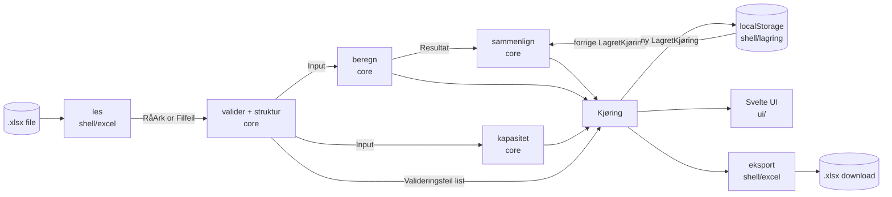
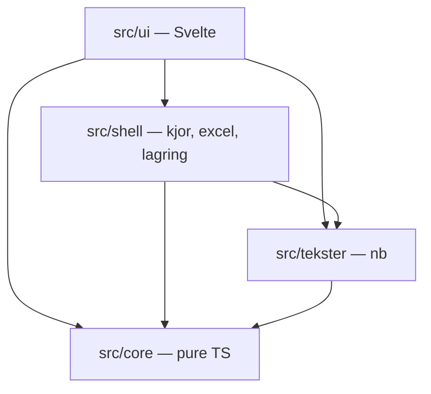
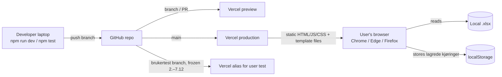

# Architecture Spine — COSI - MRP

## Design Paradigm

**Functional core, imperative shell**, arranged as a one-way pipeline. The core is pure TypeScript: data in, data out, no DOM, no browser storage, no SheetJS. The shell owns every side effect: file reading, export, `localStorage`, history and the Svelte UI. One orchestrator, `shell/kjor.ts`, runs the pipeline.



| Layer | Directory | May import |
| --- | --- | --- |
| core | `src/core/` | nothing outside `src/core/` |
| tekster | `src/tekster/` | `src/core/` types only |
| shell | `src/shell/` | `src/core/`, `src/tekster/`, SheetJS, browser APIs |
| ui | `src/ui/` | `src/core/`, `src/shell/`, `src/tekster/`, Svelte |



## Invariants & Rules

### AD-1 — Pure core, no framework or I/O [ADOPTED]

- **Binds:** NFR-1, NFR-2, FR-3–FR-13, FR-20, FR-28, FR-29, FR-31–FR-33
- **Prevents:** calculation or validation logic in Svelte components, or core code that cannot run in Vitest without a browser.
- **Rule:** `src/core/` never imports Svelte, SheetJS, `window`, `document`, `history` or `localStorage`. `valider`, `byggStruktur`, `beregn`, `kapasitet` and `sammenlign` are plain functions that take and return plain data.

### AD-2 — One owner of shared data shapes, written first

- **Binds:** all
- **Prevents:** two units declaring different shapes for the same entity, for example a `Del` as one Stykkliste row in validation and as one deduplicated part in the calculation.
- **Rule:** `src/core/typer.ts` alone declares `RåArk`, `Filfeil`, `Input`, `Struktur`, `Del`, `Resultat`, `DelResultat`, `UkeVerdier`, `Utregning`, `Eksepsjon`, `Bestillingsforslag`, `Valideringsfeil`, `Kapasitet`, `LagretKjøring`, `Sammenligning` and `Kjøring`. A foundation story writes all of them in full and merges before any story that uses them. Later shape changes go through a PR that changes `typer.ts` first. No module redeclares or locally extends a domain type, and UI view models add no domain fields.

### AD-3 — Data conventions

- **Binds:** FR-3, FR-5–FR-8, FR-10, FR-11, FR-14, FR-17, FR-20, NFR-11
- **Prevents:** off-by-one week bugs, number-vs-text item-number mismatches, and forfalt mengde modelled two ways.
- **Rule:**
  - `varenummer` is a trimmed string once `valider` has normalized it (`300001` and `"300001"` are equal).
  - In `Input` and `Resultat`, week numbers are 1..H, and every per-week series is an array of length H where index `i` is week `i + 1`. `RåArk` keeps raw values, including out-of-range weeks, so `valider` can report them.
  - `Input` carries `horisont`, `prognostisertBehov[H]` and the planned receipts as separate events (varenummer, uke, antall, excelRad). They are never pre-summed per week.
  - All quantities are integers. Only `forventetLagerbeholdning` and `disponibel` may be negative.
  - Each week's `Utregning` carries its own forfalt `{ mengde, skulleFrigisUke }`, and week 1 also carries the forfalt total. There is never a week-0 entry.

### AD-4 — Errors are values; only bugs throw

- **Binds:** FR-1, FR-4, NFR-9, FR-19
- **Prevents:** one unit throwing on bad input while another returns an error list, partial results, and different messages for the NFR-9 file cases.
- **Rule:**
  - `les` returns `{ ok: true, ark: RåArk }` or `{ ok: false, feil: Filfeil }`. `Filfeil` is a typed code with one code per whole-file case: not xlsx, empty file, corrupt file, password-protected, and the other cases in EXPERIENCE › Feil i hele fila. Each code gets its own message.
  - `valider` returns `{ ok: true, input }` or `{ ok: false, feil: Valideringsfeil[] }`. It collects every error before returning, including FR-2's rule to skip checks that depend on what is missing.
  - Core functions never throw for user-data problems. `kjor.ts` has the one `try/catch`. It turns any thrown error into a single Norwegian "uventet feil" message, renders no result and writes nothing to storage.

### AD-5 — The calculation returns everything the UI shows

- **Binds:** FR-13–FR-18, FR-22, FR-32–FR-34
- **Prevents:** the explanation panel, the lists or the export re-deriving numbers and drifting from the table.
- **Rule:**
  - `beregn` returns `Resultat`: one `DelResultat` per part in Stykkliste order. Each `DelResultat` has `uker[i]: UkeVerdier`, which holds the six row values keyed by a shared row-type union, plus an `Utregning` with the inputs behind each row: beholdning(t−1), planlagte mottak, bruttobehov per parent (varenummer, frigivelse, antall), disponibel before and after fremskynding, SS, nettobehov, fremskyndede mottak and forfalt.
  - `Resultat` also carries the derived lists, already sorted: `bestillingsforslag`, a flat `eksepsjoner` list and `kritiskeDeler`. No other unit rebuilds them.
  - `kapasitet` returns the two rows, the per-part table and the limiting parts with their reason codes, likewise ready to render.
  - The UI and the export only format these values. No code outside the core does MRP arithmetic.

### AD-6 — Codes in the core, Norwegian text in one module

- **Binds:** NFR-7, FR-4, FR-9–FR-13, FR-29, FR-18, FR-33
- **Prevents:** Norwegian strings scattered through core and components, MRP logic hidden in message formatting, and fasit tests that depend on wording.
- **Rule:**
  - `Eksepsjon` is a discriminated union per `kode` in `typer.ts`. Each variant carries every fact its FR requires, already resolved in the core:
    - FR-9: the ledetid sum and path.
    - FR-10/FR-11: disponibel after fremskynding, forfalt mengde, the week the release should have been made, total frigivelse in week 1, tidligste mottaksuke, and `konsekvens: { type: 'kunde' } | { type: 'produksjon', overordnede: { varenummer, beskrivelse }[] }`.
    - FR-12: disponibel before fremskynding, the receipt's week and quantity, the target week and `ordretype`.
    - FR-29: the receipt.
  - `Valideringsfeil` is `{ kode, ark, excelRad?, uke?, felt?, verdi?, ... }`.
  - All user-facing text is produced in `src/tekster/nb.ts`: messages, row names, explanation sentences, comparison labels and limiting reasons. Components never hard-code domain text.

### AD-7 — The stored run is compact

- **Binds:** FR-19, FR-20, FR-21, NFR-10, FR-30
- **Prevents:** units storing different shapes, hitting the `localStorage` limit, storing the uploaded file, or porting the prototype's storage.
- **Rule:**
  - Only `shell/lagring/lagret-kjoring-lager.ts` touches `localStorage`. It stores one `LagretKjøring` per finished product under `cosi-mrp:kjoring:<varenummer nivå 0>`.
  - A `LagretKjøring` holds `schemaVersjon`, varenummer and name of the finished product, timestamp, the parts (varenummer, beskrivelse), the bestillingsforslag (varenummer, frigivelsesuke, mengde) and the exceptions (varenummer, uke, type). That is under about 150 kB per product, roughly 30 products within 5 MB.
  - Deletion (FR-21) calls `removeItem` on that key. The Lagrede kjøringer view lists stored runs by enumerating the `cosi-mrp:kjoring:` prefix.
  - The only other key allowed is `cosi-mrp:intro-sett` (boolean), for the introduksjonsside (FR-27, approved by the group 22.11). If the key is missing, the intro is shown. Leaving the intro for the start page sets it.
  - Every storage call is wrapped. If storage is blocked or full, the status is "ikke lagret" and the run still shows. A stored run with an unknown `schemaVersjon` is treated as absent.
  - The prototype's `lagret`, `valg` and `sett-intro` keys are not ported.

### AD-8 — Comparison is a pure core function with a fixed order

- **Binds:** FR-20, FR-23
- **Prevents:** comparison logic split between the UI and the export with different identity rules, line order or labels.
- **Rule:** `sammenlign(forrige: LagretKjøring, ny: LagretKjøring): Sammenligning` lives in the core.
  - **Identities:** a bestillingsforslag is identified by varenummer + frigivelsesuke, and an exception by varenummer + uke + type, where `uke: null` is a valid value.
  - **Order:** groups come in the fixed order Bestillingsforslag, Eksepsjoner, Deler, and lines follow the order of the Sammenligning sheet in `testeksempel-03-fasit.xlsx`. A moved forslag is two lines, Fjernet directly followed by Nytt.
  - **Change kinds** are codes (`NY`, `ENDRET_MENGDE`, `FJERNET`, `BORTE`). Their text lives in `tekster/nb.ts`.
  - The UI and `eksport.ts` render the same `Sammenligning` without re-sorting it.

### AD-9 — One netting implementation

- **Binds:** FR-6–FR-8, FR-28, FR-31–FR-33, FR-24–FR-26
- **Prevents:** a second copy of the MRP netting rules in the capacity calculation or the lot-size extension.
- **Rule:**
  - The per-part step (disponibel, fremskynding, nettobehov, planlagt ordremottak, frigivelse) exists once in the core. It has one typed signature, a closed options type and a `mangel` output.
  - `kapasitet` calls it with options: SS 0 on ledig beholdning, no fremskynding, no orders for parts without children, and no forfalt release.
  - The lot-size rule (FR-25) is one more option of the same step.
  - Exceptions are derived after the step, from its output. They are never computed inside it.

### AD-10 — The Excel boundary

- **Binds:** FR-1, FR-2, FR-22, FR-23, NFR-11
- **Prevents:** column-position assumptions, formula evaluation, wrong row numbers, and xlsx details leaking into the core.
- **Rule:**
  - `src/shell/excel/` is the only code that imports SheetJS.
  - **Reading:** `les` produces `RåArk`, which lists every sheet found and, per sheet, the header row number, the headers found by text, and the rows as raw cell values. Each row carries its 1-based Excel row number (`excelRad`). `les` reads stored values only and never evaluates formulas.
  - **Skipped content:** Veiledning, Veien videre, Kontroll-kolonnen and the helper columns are skipped. Fully empty rows are dropped, with `excelRad` kept on the rest.
  - **Judging:** `les` never decides that a sheet, header or value is missing or wrong. That is `valider`'s job.
  - **Export:** `eksport.ts` builds the workbook from `Kjøring` (Resultat + Sammenligning).
  - App code never reads fasit files.

### AD-11 — Tests are independent of the reference code

- **Binds:** NFR-2, NFR-5, SM-1, SM-2, SM-4, SM-5, SM-7
- **Prevents:** tests that compare the app with itself.
- **Rule:**
  - **No porting:** `testdata/lag_testdata.py` is never imported, ported or transliterated into `src/`. It may still generate input files, such as `testdata/ytelse-1000.xlsx` for NFR-5.
  - **Fasit tests:** they read `testdata/*-fasit.xlsx` through a test-only helper in `tests/` and run the app path (`les` → `valider` → `beregn`/`kapasitet` → `sammenlign` → `eksport`) on the matching input files.
  - **What is compared:** numbers per part, week and row; exceptions on (varenummer, uke, type); validation errors on (ark, excelRad, felt, kode); and comparison lines in order. Wording is not compared.
  - **One command:** `npm test` runs everything with no network, keys or accounts.

### AD-12 — Static, data-free deployment and environments [ADOPTED]

- **Binds:** NFR-3, NFR-4, NFR-6, §8.1
- **Prevents:** any part of the solution sending data out of the browser, and builders expressing cut features or the test build in different ways.
- **Rule:**
  - **Hosting:** the Vite production build is deployed to Vercel as static files only. There are no serverless or edge functions, no analytics, no Speed Insights and no telemetry, and the Vercel toolbar is off on previews. No third-party scripts or fonts are loaded at runtime. The template and testeksempel 01 (FR-27) are bundled from the repo.
  - **Environments:** `dev` (local), `preview` (Vercel per branch or PR) and `production` (`main`).
  - **Capacity flag:** one build-time flag, `VITE_KAPASITET` (default on), hides the radio group and the capacity paths when trinn 4 is cut and in the test build.
  - **Test week:** the user test (2.–7.12) uses a fixed Vercel alias on a `brukertest` branch, frozen for that week.

### AD-13 — UI port of Oda's v3 with PRD defaults

- **Binds:** FR-14–FR-18, FR-27, FR-30, FR-34, NFR-8, PRD §4.4
- **Prevents:** builders porting the prototype's toggles or non-PRD defaults, pulling in different component libraries, or inventing their own layout.
- **Rule:** the Svelte UI is ported from `ux-prototype-2026-11-17-v3/index.html`, reusing its HTML and CSS. The prototype files themselves are not edited.
  - **Fixed choices, not settings:**
    - Result order (PRD §4.4, approved 22.11): Tallbokser → Kritiske deler → Bestillingsforslag → Endringer (when present) → Resultattabell → Produksjonskapasitet (when chosen). The Seksjonsmeny follows the same order.
    - With no critical parts, the Kritiske deler section shows only the short message from FR-16 and no list.
    - «Vis bare kritiske deler» above the Resultattabell starts off. It is UI view state that filters on `Resultat.kritiskeDeler`, keeps Stykkliste order, and never reaches `eksport.ts` (FR-16).
    - Exception labels show the official type name first.
    - The week filter starts on Uke 1.
    - There is no Ukeplan.
    - Bestillingsplan is preselected in the radio group.
  - **Not ported:** the Prototypevalg panel, the hash router, the light/dark toggle (light only in v1) and the prototype's `localStorage` keys.
  - **Naming:** the boxes at the top of the result are `Tallboks` (four, plus one for Endringer when present), and the row of section buttons is `Seksjonsmeny`, in code and in accessible names. Neither is called "Sammendrag", which is FR-16's list of critical parts. Every count in a Tallboks is read from `Resultat` or `Sammenligning`, never recounted in the UI (AD-5). `Statuslinje` is only the start page's progress text.
  - **Interactive primitives:** native HTML (`<dialog>`, `<select>`, `fieldset` with radio buttons), with the keyboard and focus behaviour in EXPERIENCE. This replaces EXPERIENCE's shadcn/ui + Tailwind + Radix choice. No headless component library is used.

### AD-14 — View state, history and announcements

- **Binds:** FR-1, FR-27, FR-30, EXPERIENCE › Adresse og historikk, Accessibility Floor
- **Prevents:** hash or path routes in some views and store state in others, results surviving a reload in one view only, and lost screen-reader announcements.
- **Rule:**
  - One Svelte store holds the current view and the in-memory `Kjøring`. The URL never encodes the view.
  - **Views:** intro (menu «Introduksjon»), start (menu «Ny kjøring»), resultat (menu «Resultat») and lagrede kjøringer (menu «Lagrede kjøringer»). The first view is intro if `cosi-mrp:intro-sett` is missing (AD-7), otherwise start.
  - **History:** showing the result calls `history.pushState` once. `popstate` moves the store to start (Back) or back to the in-memory result (Forward). A reload always returns to start.
  - The result and the uploaded file live only in memory.
  - One `role="status"` live region sits in the root component and is never re-mounted when views swap.

### AD-15 — One owner of the BOM structure

- **Binds:** FR-3, FR-5, FR-9, FR-10, FR-28, FR-31
- **Prevents:** validation, calculation, exceptions and capacity each building their own tree with different parent lists, low-level codes or paths.
- **Rule:**
  - `core/struktur.ts` alone builds `Struktur` from the validated rows: deduplicated parts in first-occurrence order, merged edges with antall, parents per part, lavnivåkode, the longest ledetid path from the finished product, and antall per ferdigprodukt.
  - `valider` uses it for the subpart checks. `beregn`, the exception rules and `kapasitet` read only `Struktur` and never the raw rows.
  - Parts are calculated in ascending lavnivåkode, with ties broken by Stykkliste order.

### AD-16 — One orchestrator, fixed run order

- **Binds:** FR-4, FR-19, FR-20, FR-30, NFR-9, NFR-10
- **Prevents:** a run comparing with itself, storage changing on a failed run, and capacity-only runs being stored.
- **Rule:**
  - Only `shell/kjor.ts` runs a run, taking the calculation choice as an argument. The order is fixed:
    1. `les`
    2. `valider` (with `byggStruktur`)
    3. read the previous `LagretKjøring`
    4. run every chosen calculation
    5. `sammenlign`
    6. build one `Kjøring` (recording the choice)
    7. write the new `LagretKjøring`, only when the bestillingsplan was chosen and every step succeeded
    8. hand the `Kjøring` to the store
  - A failure at any step replaces the store's `Kjøring` with the error state and writes nothing.

## Consistency Conventions

| Concern | Convention |
| --- | --- |
| Domain naming | Norwegian ordbank terms in code identifiers (`bruttobehov`, `nettobehov`, `planlagtOrdremottak`, `frigivelsesuke`, `eksepsjon`, `kritiskDel`), camelCase for values and PascalCase for types. Framework and tooling words stay English. New terms go into `.docs/ordbank.md` first. |
| Files | Core, shell and tekster use `kebab-case.ts`. Svelte components use `PascalCase.svelte`. Tests are `*.test.ts` in `tests/`, mirroring `src/`. |
| Exception codes | `LEDETID_OVERSKRIDER_HORISONT`, `BESTILLING_FORSINKET`, `BRUK_AV_SIKKERHETSLAGER`, `MOTTAK_FORSINKET`, `KANSELLER_MOTTAK`. A whole-part exception has `uke: null` and is rendered as "–". |
| Ordering | Parts follow Stykkliste order, with a shared part at its first occurrence (FR-16). Bestillingsforslag are sorted by frigivelsesuke, then Stykkliste order. Exceptions are sorted by Stykkliste order, then week (`null` first), then the code order above. Comparison order is set in AD-8. |
| Status in UI | Reading, calculating, not-stored and whole-file errors go through the root live region (AD-14) and the status areas EXPERIENCE defines. No `alert()`. |
| Accessibility | Markers use color plus a symbol or text (NFR-8). The explanation panel opens on click or Enter, never on hover (FR-18). |
| Formatting | Integers without decimals. Norwegian number formatting via `Intl.NumberFormat('nb-NO')` in `tekster/`. |
| Performance (NFR-5) | Measured with `performance.mark` from the Beregn click to the first paint of Resultattabell, with "Begge" chosen, on `testdata/ytelse-1000.xlsx` in Chrome on a normal laptop. The result is recorded in a test note. A core-only Vitest benchmark guards against regressions. |
| Commands (README, NFR-3) | `npm install`, `npm run dev`, `npm test`, `npm run build`. |

## Stack

| Name | Version |
| --- | --- |
| TypeScript | 6.0.3 |
| Vite | 8.3.8 |
| Svelte | 5.59.1 |
| @sveltejs/vite-plugin-svelte | 7.3.1 |
| svelte-check | 4.7.8 |
| Vitest | 5.1.1 |
| SheetJS CE (`npm i https://cdn.sheetjs.com/xlsx-0.20.3/xlsx-0.20.3.tgz`, never `npm i xlsx`) | 0.20.3 |
| Node.js (`engines`, also set in Vercel) | ^22.12.0 \|\| ^24.0.0 \|\| >=26.0.0, Node 24 LTS recommended |
| Hosting | Vercel, static |

## Structural Seed

```text
/
  src/
    core/            # typer.ts, valider.ts, struktur.ts, netting.ts, beregn.ts, eksepsjoner.ts, kapasitet.ts, lagret-kjoring.ts, sammenlign.ts
    shell/
      excel/         # les.ts (xlsx → RåArk | Filfeil), eksport.ts (Kjøring → xlsx)
      lagring/       # lagret-kjoring-lager.ts (localStorage, fail-safe)
      kjor.ts        # the only pipeline orchestrator (AD-16)
    tekster/         # nb.ts: all Norwegian text
    ui/              # Svelte components ported from Oda's v3, app store, root live region
    main.ts
  public/            # COSI-MRP-mal.xlsx, testeksempel-01.xlsx (copied from testdata/)
  tests/             # Vitest: core unit, fasit, validering, export tests, fasit-leser.ts helper, benchmark
  testdata/          # template, testeksempler, fasit, validering, lag_testdata.py, ytelse-1000.xlsx
```



## Capability → Architecture Map

| Capability / Area | Lives in | Governed by |
| --- | --- | --- |
| FR-1–FR-2 upload and structure | `shell/excel/les.ts`, `core/valider.ts` | AD-4, AD-10 |
| FR-3–FR-4 value checks, all errors at once | `core/valider.ts`, `core/struktur.ts`, `tekster/nb.ts` | AD-4, AD-6, AD-15 |
| FR-5–FR-8, FR-28 MRP calculation | `core/beregn.ts`, `core/netting.ts` | AD-3, AD-9, AD-15 |
| FR-9–FR-13, FR-29 exceptions | `core/eksepsjoner.ts` | AD-6, AD-9 |
| FR-14–FR-17 result views | `ui/` | AD-5, AD-13 |
| FR-18 explanations | `core/beregn.ts` (Utregning), `tekster/`, `ui/` | AD-5, AD-6 |
| FR-19–FR-21 stored run and comparison | `core/lagret-kjoring.ts`, `core/sammenlign.ts`, `shell/lagring/`, `shell/kjor.ts` | AD-7, AD-8, AD-16 |
| FR-22–FR-23 export | `shell/excel/eksport.ts` | AD-5, AD-8, AD-10 |
| FR-24–FR-26 fixed lot size | `core/netting.ts` option | AD-9 |
| FR-27 guide and downloads | `ui/`, `public/` | AD-12, AD-13 |
| FR-30–FR-34 production capacity | `core/kapasitet.ts`, `ui/` | AD-5, AD-9, AD-12 flag, AD-16 |
| NFR-2 tests against fasit | `tests/` | AD-11 |
| NFR-4 data stays local | build and deploy | AD-12 |
| NFR-5 performance | `tests/` benchmark, manual measurement | Conventions |
| NFR-9 robust errors | `shell/excel/les.ts`, `shell/kjor.ts` | AD-4, AD-16 |

## Deferred

- **Web Worker for the pipeline.** v1 runs on the main thread. If the NFR-5 measurement misses 3 s, a Worker comes before any table virtualisation.
- **Component breakdown inside `ui/`.** It follows the prototype's sections, and stories decide the split.
- **Capacity with fixed lot size.** Capacity stays lot-for-lot until trinn 5 is built. It is decided then, as an AD-9 option.
- **English text.** `tekster/` is the seam (AD-6). Not built in v1.
- **CI.** `npm test` locally is the contract (NFR-2). A GitHub Action can be added without changing anything here.
- **Multi-product planning, scenarios, more than three levels.** Outside v1 (PRD §7.2). The per-product storage key (AD-7) is the only constraint they inherit.
