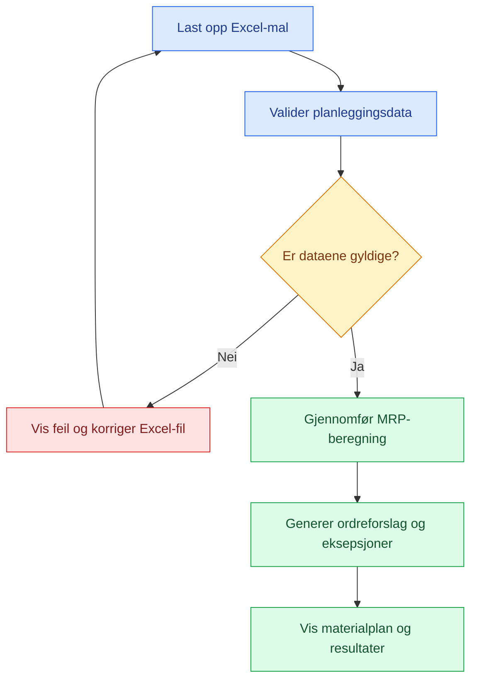

# PRD: COSI-MRP – Carmens utkast

**Status:** Arbeidsutkast. Ikke gjennomgått av gruppen.

## 1. Visjon

COSI-MRP skal gjøre material- og produksjonsplanlegging enklere, mer oversiktlig og etterprøvbar for små produksjonsbedrifter. I virksomheter der planleggingen gjennomføres manuelt i Excel, kan beregningene være tidkrevende og vanskelige å kontrollere. Dette kan gjøre det utfordrende å oppdage materialmangel og vurdere konsekvensene av endringer i produksjonsplanen.

COSI-MRP skal være en nettbasert applikasjon som bruker data fra en standardisert Excel-mal til å beregne materialbehov og foreslå når komponenter må bestilles eller settes i produksjon.

Løsningen skal gi produksjons- og materialplanleggeren en samlet oversikt over behov, planlagte ordre og avvik. Beregningene skal kunne forklares og kontrolleres, slik at brukeren forstår hvorfor systemet foreslår bestemte handlinger.

Første versjon skal være avgrenset til ett ferdigprodukt per beregning og en stykkliste med inntil tre nivåer. På lengre sikt er målet å videreutvikle løsningen slik at den kan håndtere flere ferdigprodukter og tas i bruk av flere bedrifter.

## 2. Målbruker

### 2.1 Brukerroller

COSI-MRP skal støtte ulike roller som er involvert i material- og produksjonsplanlegging.

- **Produksjons- og materialplanlegger (primærbruker):** Planlegger materialbehov, vurderer lagerbeholdning og bestemmer når innkjøp eller egenproduksjon må igangsettes.
- **Innkjøper (sekundærbruker):** Bruker bestillingsforslagene til å vurdere hvilke komponenter som må kjøpes inn, og når leverandørbestillinger bør sendes.
- **Produksjonsleder (sekundærbruker):** Bruker oversikten til å vurdere om materialene er tilgjengelige når produksjonen skal gjennomføres.

### 2.2 Viktige brukerbehov

Det viktigste for brukerne er ikke bare å få beregnet materialbehovet, men å kunne bruke resultatene til å ta riktige beslutninger.

COSI-MRP skal derfor hjelpe brukeren med å:

- Oppdage fremtidig materialmangel før den påvirker produksjonen.
- Skille mellom komponenter som må kjøpes inn og komponenter som må produseres internt.
- Forstå når en ordre må frigjøres for at materialene skal være tilgjengelige i tide.
- Vurdere hvordan endringer i produksjonsplanen påvirker materialbehovet.
- Kontrollere beregningene og forstå hvorfor bestemte tiltak foreslås.

### 2.3 Typiske brukssituasjoner

**Situasjon 1 – Forebygge materialmangel**

En materialplanlegger skal planlegge produksjonen for de kommende ukene. Etter at planleggingsdataene er lastet opp, viser COSI-MRP at en komponent vil mangle før planlagt produksjonsstart. Systemet viser når en ny ordre må frigis, slik at planleggeren kan handle før mangelen oppstår.

**Situasjon 2 – Planlegge egenproduksjon**

En produksjonsbedrift produserer enkelte komponenter selv. COSI-MRP beregner behovet for disse komponentene og tar hensyn til at de igjen kan kreve underliggende materialer. Produksjonsplanleggeren får dermed oversikt over når intern produksjon må starte, og hvilke materialer som må være tilgjengelige.

**Situasjon 3 – Korrigere feil i planleggingsdata**

En bruker laster opp en Excel-fil med feil i lagerbeholdningen eller stykklisteoppbygningen. COSI-MRP identifiserer feilene og gir en forståelig tilbakemelding om hva som må rettes før beregningen kan gjennomføres.

### 2.4 Avgrensning av målgruppen

Første versjon er rettet mot brukere med relativt enkle planleggingsbehov. Virksomheter som trenger samtidig planlegging av flere ferdigprodukter, mer omfattende stykklister eller integrasjon med økonomi- og ordresystemer, faller utenfor det første utviklingsomfanget.

De ulike brukerrollene skal kunne benytte samme løsning, uten separate tilgangsnivåer eller funksjoner for samarbeid i sanntid.

## 3. Ordliste

Ordlisten beskriver sentrale begreper innen materialplanlegging, produktstruktur og systemfunksjonalitet som benyttes i COSI-MRP.

### 3.1 Produktstruktur og komponenter

| Begrep | Forklaring |
|---|---|
| BOM (Bill of Materials) | Stykkliste som beskriver hvilke komponenter et produkt består av, og hvor mange enheter av hver komponent som kreves. |
| Flernivå-BOM | Stykkliste der komponenter kan bestå av andre komponenter, slik at produktet får flere nivåer. |
| BOM-eksplosjon | Beregning der behovet for et produkt brytes ned til behov for komponenter på underliggende nivåer. |
| Ferdigprodukt | Produktet som skal produseres og som danner utgangspunktet for MRP-beregningen. |
| Komponent | En del som inngår i et ferdigprodukt eller en annen komponent. |
| Innkjøpt komponent | Komponent som anskaffes fra en ekstern leverandør. |
| Egenprodusert komponent | Komponent som produseres internt og som selv kan ha behov for underliggende materialer. |
| Type | Varens kategori i stykklisten i Excel-malen: `Ferdigvare`, `Komponent (Kjøpes inn)` eller `Komponent (Produseres selv)`. `Ferdigvare` brukes bare for ferdigproduktet. `Komponent (Kjøpes inn)` er en innkjøpt komponent, og `Komponent (Produseres selv)` er en egenprodusert komponent. Typen avgjør om et ordreforslag er en innkjøpsordre eller en produksjonsordre. |
| BOM-nivå | Angir hvor en vare er plassert i produktstrukturen. COSI-MRP benytter nivå 0 for ferdigproduktet og nivå .1 og ..2 for komponentene. |
| Overordnet del | Produktet eller komponenten som en underliggende komponent inngår i. |
| Felleskomponent | Komponent som forekommer flere steder i produktstrukturen, men representerer samme varenummer. |
| Lavnivåkode | Det dypeste nivået en komponent forekommer på i stykklisten, brukt for å sikre korrekt beregningsrekkefølge. |
| Varenummer | Unik identifikasjon av et produkt eller en komponent. Samme varenummer skal representere samme vare. |
| Antall per enhet | Antall enheter av en komponent som kreves for å produsere én enhet av den overordnede delen. |

### 3.2 Planleggingsgrunnlag

| Begrep | Forklaring |
|---|---|
| MRP (Material Requirements Planning) | Metode for å beregne hvilke materialer som trengs, i hvilke mengder og når de må være tilgjengelige. |
| MPS (Master Production Schedule) | Hovedproduksjonsplan som viser planlagt behov for ferdigprodukter fordelt på perioder. |
| Planleggingshorisont | Tidsrommet MRP-beregningen omfatter. I første versjon av COSI-MRP er dette 8–12 uker. |
| Planleggingsperiode | Tidsenheten som benyttes i beregningen. I COSI-MRP er én periode lik én uke. |
| Lagerbeholdning | Antall enheter av en vare som finnes på lager ved starten av planleggingshorisonten. |
| Inngående lager | Lagerbeholdningen ved starten av en bestemt periode. Den er lik forventet lagerbeholdning ved slutten av perioden før, og i første periode lik lagerbeholdningen. |
| Sikkerhetslager (SS) | Lagerbeholdning som planlegges opprettholdt for å redusere risikoen for materialmangel. |
| Ledetid (L) | Antall uker fra en ordre frigis til varen er tilgjengelig, enten gjennom innkjøp eller egenproduksjon. |
| Planlagte mottak | Leveranser eller produksjonsordre som allerede er bestilt eller igangsatt, og som forventes mottatt i en bestemt periode. |
| Excel-mal | Standardisert regneark som benyttes til å registrere og overføre planleggingsdata til COSI-MRP. |

### 3.3 MRP-beregninger

| Begrep | Forklaring |
|---|---|
| Bruttobehov | Samlet behov for en vare i en periode, før tilgjengelig lager og planlagte mottak tas hensyn til. |
| Disponibel beholdning | Beregnet lagerbeholdning etter periodens bruttobehov og allerede planlagte mottak, men før nye ordremottak legges til. |
| Nettobehov | Mengden som må tilføres for å dekke bruttobehovet og samtidig opprettholde sikkerhetslageret. |
| Forventet lagerbeholdning | Beregnet beholdning ved slutten av en periode, etter at bruttobehov, planlagte mottak og planlagte ordremottak er tatt hensyn til. |
| Bestillingsregel | Regel som bestemmer hvor stor mengde som skal foreslås bestilt eller produsert. |
| Lot-for-lot (L4L) | Partistørrelsesregel der planlagt ordremottak tilsvarer det beregnede nettobehovet. |
| Fast partistørrelse | Partistørrelsesregel der ordremengden rundes opp til et helt antall faste partier. |
| Beregningsrekkefølge | Rekkefølgen MRP behandler varene i, slik at behov fra overordnede deler er beregnet før underliggende komponenter behandles. |

### 3.4 Ordre og avvik

| Begrep | Forklaring |
|---|---|
| Planlagt ordremottak | Mengden fra en ny foreslått ordre som skal være tilgjengelig i en bestemt periode. |
| Planlagt ordrefrigivelse | Uken og mengden en ny innkjøps- eller produksjonsordre må frigis, beregnet ut fra ønsket mottaksuke og ledetid. |
| Ordreforslag | Systemets anbefaling om mengde og tidspunkt for en innkjøps- eller produksjonsordre. |
| Innkjøpsordre | Ordre om anskaffelse av varer fra en ekstern leverandør. |
| Produksjonsordre | Ordre om å produsere et ferdigprodukt eller en komponent internt. |
| Forfalt ordrefrigivelse | En planlagt ordrefrigivelse som etter beregnet ledetid skulle vært frigitt før første uke i planleggingshorisonten. Den legges i uke 1 og markeres som forfalt. |
| Eksepsjonsmelding | Varsel om et forhold som krever oppmerksomhet eller handling. COSI-MRP har fire typer: Ledetid overskrider horisont, Bestilling forsinket, Bruk av sikkerhetslager og Mottak forsinket (FR-13–FR-16). |
| Kritisk vare | Ferdigprodukt eller komponent som har minst én eksepsjon som krever oppfølging. |

### 3.5 System, datakvalitet og testing

| Begrep | Forklaring |
|---|---|
| Datavalidering | Kontroll av at opplastede data har riktig format, gyldige verdier og nødvendig informasjon før beregning. |
| BOM-validering | Kontroll av at stykklisten har gyldige nivåer, varenummer og sammenhenger mellom komponentene. |
| Valideringsfeil | Feil i datagrunnlaget som må korrigeres før MRP-beregningen kan gjennomføres. |
| Kjøring | Én gjennomføring av MRP-beregningen basert på et bestemt datagrunnlag. |
| Resultattabell | Oversikt over beregnede materialbehov, lagerbeholdning, ordremottak og ordrefrigivelser fordelt på perioder. |
| Sporbarhet | Muligheten til å følge et beregningsresultat tilbake til inndataene og beregningstrinnene som ligger bak. |
| Forklarbarhet | Systemets evne til å vise hvorfor et bestemt materialbehov eller ordreforslag er beregnet. |
| Før/etter-sammenligning | Sammenstilling av resultater fra to beregninger for å vise hvilke materialbehov eller ordreforslag som har endret seg. |
| Kontrollkolonne | Kolonnen «Kontroll» i Excel-malens stykkliste, som gir tilbakemelding om mulige feil eller mangler i registrerte data. |
| Testfasit | Uavhengig kontrollert sett med forventede beregningsresultater som brukes til å verifisere at systemet beregner riktig. |

## 4. Funksjoner

COSI-MRP er en nettbasert løsning for materialbehovsplanlegging. Brukeren registrerer planleggingsdataene i en standardisert Excel-mal og laster filen opp i løsningen. Systemet validerer dataene, gjennomfører MRP-beregningen og presenterer ordreforslag, eksepsjonsmeldinger og en forklarbar materialplan.

Første versjon har følgende rammer:

- ett ferdigprodukt per beregning
- inntil tre BOM-nivåer (`0`, `.1` og `..2`)
- en planleggingshorisont på 8–12 uker
- inntil 1000 rader i stykklisten

Figur 4.1 viser den overordnede arbeidsflyten. Hvert steg er beskrevet nærmere i funksjonskravene under.

*Figur 4.1: Overordnet arbeidsflyt i COSI-MRP (foreløpig forslag).*

**Prioritering.** Funksjonskravene er delt i to grupper:

| Prioritet | Krav | Betydning |
|---|---|---|
| Obligatorisk | FR-01–FR-21 og FR-26 | Utgjør MRP-kjernen. Alle må være oppfylt før første versjon kan godkjennes. |
| Prioritert tillegg | FR-22–FR-25 | Kan påbegynnes parallelt med kjernen, men ferdigstilles først når MRP-kjernen er testet mot testfasit (§7.3). Er ikke krav for å godkjenne MRP-kjernen. |

Akseptansekriteriene viser til testeksemplene i `testdata/`. Testeksempel 01 har ferdigproduktet og åtte innkjøpte komponenter på nivå `.1`. Testeksempel 02 har en stykkliste på tre nivåer med egenproduserte komponenter og en felleskomponent. Testfasiten for testeksempel 02 er kontrollert for hånd. Status for testfasiten til testeksempel 01 står i §8.2.

Begrepene følger ordlisten i §3. Det skilles konsekvent mellom **planlagte mottak** (ordre som allerede er bestilt eller igangsatt, og som er registrert i Excel-malen), **planlagte ordremottak** (nye ordre som systemet foreslår) og **planlagte ordrefrigivelser** (uken og mengden de nye ordrene må frigis).

### 4.1 Opplasting og validering av Excel-data

Før noe beregnes, skal systemet kontrollere at filen følger Excel-malen og at alle verdier er gyldige. Excel-malen har nedtrekkslister, datavalidering og en kontrollkolonne, men disse kan omgås. Innliming fjerner nedtrekkslisten og valideringen i cellen, og filen kan være redigert i et annet regneark. Systemet skal derfor validere alle regler selv, uavhengig av kontrollene i Excel-malen.

#### FR-01: Last opp Excel-fil

**Prioritet:** Obligatorisk

Brukeren skal kunne velge og laste opp én `.xlsx`-fil fra egen maskin. En opplasting som avvises eller har valideringsfeil, skal ikke erstatte resultatet fra en tidligere vellykket beregning i gjeldende økt. Resultatet vises fortsatt, sammen med valideringsfeilene for den nye filen. Kravet gjelder bare økten som pågår. Lagring av resultatet mellom økter er en prioritert tilleggsfunksjon og er beskrevet i FR-22.

**Akseptansekriterier:**
- `testdata/testeksempel-01.xlsx` og `testdata/testeksempel-02.xlsx` lastes opp uten endringer og går videre til validering.
- En fil med en annen filtype enn `.xlsx` avvises med en melding om at systemet bare tar imot Excel-malen.
- Resultatet fra en tidligere vellykket beregning i samme økt vises fortsatt, uendret, etter en opplasting som avvises eller har valideringsfeil.

#### FR-02: Kontroller arkene og kolonnene

**Prioritet:** Obligatorisk

Systemet skal kontrollere at filen inneholder arkene `Stykkliste`, `MPS` og `Planlagte mottak`, og at hvert ark har de obligatoriske kolonneoverskriftene fra Excel-malen:

| Ark | Obligatoriske kolonner |
|---|---|
| `Stykkliste` | Nivå, Varenummer, Beskrivelse, Antall, Type, Lagerbeholdning, Sikkerhetslager, Ledetid (uker) |
| `MPS` | Uke, Antall ferdigprodukter |
| `Planlagte mottak` | Varenummer, Uke, Antall |

Arkene `Veiledning` og `Veien videre`, kontrollkolonnen og de andre hjelpekolonnene til høyre for tabellene skal ikke leses inn og skal ikke påvirke valideringen.

**Akseptansekriterier:**
- En fil der et av de tre arkene mangler, gir én valideringsfeil som oppgir hvilket ark som mangler.
- En fil der en obligatorisk kolonneoverskrift mangler, gir én valideringsfeil som oppgir ark og kolonne.
- En fil der kontrollkolonnen inneholder tekst, eller der arket `Veiledning` er endret, gir samme resultat som den samme filen uten disse endringene.

#### FR-03: Valider verdiene

**Prioritet:** Obligatorisk

Systemet skal kontrollere hver verdi etter reglene i tabellen. En rad regnes som tom når alle de obligatoriske kolonnene i raden er tomme.

| Ark | Felt | Regel |
|---|---|---|
| Stykkliste | Rader | Starter i rad 2 og er sammenhengende nedover. Tabellen slutter ved første tomme rad. Finnes det utfylte rader etter en tom rad, er det en valideringsfeil. Inntil 1000 rader. |
| Stykkliste | Ferdigprodukt | Nøyaktig én rad har nivå `0`, og det er første rad. Minst én rad har nivå `.1`. |
| Stykkliste | Nivå | `0`, `.1` eller `..2`. Alle andre verdier er ugyldige, også verdier som er limt inn, for eksempel `3`, `.2` eller `0,1`. Om nivå `0` lagret som tall skal godtas, er et åpent spørsmål (§9, spørsmål 8). |
| Stykkliste | Varenummer | Obligatorisk. |
| Stykkliste | Beskrivelse | Obligatorisk. |
| Stykkliste | Antall | Tom for ferdigproduktet. Positivt heltall (≥ 1) for komponenter, angitt som antall per enhet av den overordnede delen. |
| Stykkliste | Type | `Ferdigvare`, `Komponent (Kjøpes inn)` eller `Komponent (Produseres selv)`. `Ferdigvare` brukes på nivå `0` og bare der. |
| Stykkliste | Lagerbeholdning, Sikkerhetslager | Heltall ≥ 0. |
| Stykkliste | Ledetid (uker) | Heltall ≥ 1 for komponenter og ≥ 0 for ferdigproduktet. |
| Stykkliste | Gjentatt varenummer | Lagerbeholdning, sikkerhetslager og ledetid fylles ut på første forekomst av varenummeret og er tomme på senere forekomster. |
| MPS | Uker | 8–12 sammenhengende uker fra uke 1. En utfylt uke etter en tom uke er en valideringsfeil. Antall uker utgjør planleggingshorisonten (H). |
| MPS | Antall ferdigprodukter | Heltall ≥ 0. |
| Planlagte mottak | Rader | Arket kan være tomt. Finnes det utfylte rader etter en tom rad, er det en valideringsfeil. |
| Planlagte mottak | Varenummer | Finnes i stykklisten. |
| Planlagte mottak | Uke | Heltall fra 1 til H. |
| Planlagte mottak | Antall | Positivt heltall (≥ 1). |

**Akseptansekriterier:**
- Hver regel i tabellen har minst ett testtilfelle der en fil med nøyaktig den ene feilen gir nøyaktig én valideringsfeil.
- Nivået `.2` eller `3`, og typen `Delmontering`, limt inn i en celle med nedtrekksliste, gir en valideringsfeil selv om Excel ikke stoppet verdien.
- En stykkliste med en tom rad mellom to utfylte rader gir en valideringsfeil som oppgir raden som er tom.
- Et tomt ark `Planlagte mottak` er gyldig.
- En vare med lagerbeholdning 0 eller sikkerhetslager 0 er gyldig.
- Et ferdigprodukt med ledetid 0 er gyldig. En komponent med ledetid 0 gir en valideringsfeil.
- MPS med 7 eller 13 utfylte uker gir en valideringsfeil. MPS med 8 og med 12 utfylte uker er gyldig.

*Avklares i gruppen:* Excel kan lagre nivå `0` som tallet 0 i stedet for som tekst. Forslaget er at tallet 0 godtas som nivå `0`, mens alle andre tallverdier er ugyldige.

#### FR-04: Valider BOM-strukturen

**Prioritet:** Obligatorisk

Systemet skal kontrollere at stykklisten danner en gyldig produktstruktur:

- En rad med nivå `.1` hører til ferdigproduktet.
- En rad med nivå `..2` hører til nærmeste foregående rad med nivå `.1`. Flere påfølgende `..2`-rader under samme `.1`-rad er søsken.
- Nivå `..2` kan bare stå rett under en `.1`-rad eller en annen `..2`-rad. Etter en `..2`-rad kan strukturen gå tilbake til nivå `.1`.
- En vare med type `Komponent (Kjøpes inn)` kan ikke ha underliggende komponenter.
- En vare kan ikke inngå i seg selv, verken direkte eller gjennom en annen vare (sirkulær avhengighet).
- Rader med samme varenummer må ha samme beskrivelse og samme type. Ulike opplysninger for samme varenummer er en valideringsfeil.
- Felleskomponenter er tillatt. En vare uten underliggende komponenter kan stå flere steder i stykklisten.
- **Avgrensning i første versjon:** En egenprodusert vare med underliggende komponenter kan bare forekomme én gang i stykklisten. Avgrensningen gjør beregningsrekkefølgen entydig. Den erstatter ikke kontrollen av sirkulære avhengigheter, som gjennomføres separat.

**Akseptansekriterier:**
- En stykkliste der første rad har et annet nivå enn `0`, gir en valideringsfeil.
- En `..2`-rad rett under ferdigproduktet gir en valideringsfeil.
- En `Komponent (Kjøpes inn)` med en `..2`-rad under seg gir en valideringsfeil.
- En komponent som står under seg selv, gir en valideringsfeil om sirkulær avhengighet.
- En stykkliste der 200-001 står under 200-002 og 200-002 står under 200-001, gir en valideringsfeil om sirkulær avhengighet, i tillegg til feilen om at en vare med underliggende komponenter forekommer mer enn én gang.
- Samme varenummer med ulik beskrivelse eller ulik type gir en valideringsfeil.
- I testeksempel 02 godtas 300-002 Skruesett M6, som står under både 200-001 Sete og 200-002 Rygg.
- En `Komponent (Produseres selv)` med underliggende komponenter som står på to steder i stykklisten, gir en valideringsfeil.

#### FR-05: Vis alle valideringsfeil samlet

**Prioritet:** Obligatorisk

Finnes det minst én valideringsfeil, skal systemet vise alle feilene i én samlet liste og ikke gjennomføre MRP-beregningen. Hver feil skal oppgi ark, rad eller celle, felt, hva som er feil og et konkret forslag til hvordan feilen rettes.

**Akseptansekriterier:**
- En fil med tre feil på tre forskjellige ark gir én liste med tre feil.
- Hver feil i listen oppgir ark, rad eller celle, felt, årsak og korrigeringsforslag, for eksempel: «Stykkliste, rad 5, Sikkerhetslager: mangler verdi. Fyll inn et heltall på 0 eller mer.»
- Ingen beregning gjøres, og ingen resultattabell, ordreforslag eller eksepsjoner vises for filen med valideringsfeil. Et tidligere resultat fra samme økt vises fortsatt (FR-01).

### 4.2 Produktstruktur og MRP-beregninger

MRP-beregningen gjennomføres for hvert varenummer over hele planleggingshorisonten, også for ferdigproduktet. Behovet brytes ned nivå for nivå (BOM-eksplosjon): de planlagte ordrefrigivelsene for en vare danner bruttobehovet for varene rett under den. Beregningen er deterministisk, slik at samme fil alltid gir samme resultat, og den skal kunne testes uten opplasting og brukergrensesnitt.

#### FR-06: Beregn bruttobehov

**Prioritet:** Obligatorisk

For ferdigproduktet er bruttobehovet i hver uke lik MPS for uken. For en komponent er bruttobehovet summen av de planlagte ordrefrigivelsene for den overordnede delen, multiplisert med antall per enhet:

Bruttobehov(t) = Σ Planlagt ordrefrigivelse for overordnet del(t) × Antall per enhet

**Akseptansekriterier:**
- Bruttobehovet for 100-001 i testeksempel 02 er lik MPS: 30, 30, 35, 25, 40, 35, 30, 45, 35, 30.
- Bruttobehovet for 200-001 Sete (antall 1) i testeksempel 02 er lik de planlagte ordrefrigivelsene for 100-001: 45, 35, 25, 40, 35, 30, 45, 35, 30, 0.
- En vare på nivå `..2` får bruttobehovet sitt fra den overordnede `.1`-raden, ikke fra MPS.
- Bruttobehovet for alle varer i testeksempel 01 og 02 er identisk med testfasiten.

#### FR-07: Beregn felleskomponenter én gang

**Prioritet:** Obligatorisk

En felleskomponent skal ha én samlet beregning per varenummer. Varene beregnes i rekkefølge etter lavnivåkode, slik at alle bidrag fra overordnede deler er summert før lagerbeholdning og nettobehov beregnes. Lagerbeholdning, sikkerhetslager og ledetid hentes fra første forekomst av varenummeret, og lageret trekkes fra bare én gang. Planlagte mottak for varenummeret gjelder den samlede beregningen.

**Akseptansekriterier:**
- 300-002 Skruesett M6 i testeksempel 02 har én MRP-tabell, med bruttobehov(t) = 4 × planlagt ordrefrigivelse for 200-001(t) + 2 × planlagt ordrefrigivelse for 200-002(t). I uke 1 gir det 4 × 55 + 2 × 0 = 220.
- Lagerbeholdningen for 300-002 (400) brukes bare én gang i beregningen.
- En felleskomponent beregnes først etter at alle varene den inngår i, er beregnet.

#### FR-08: Beregn disponibel beholdning og nettobehov

**Prioritet:** Obligatorisk

For hver vare og uke skal systemet beregne:

Disponibel beholdning(t) = Forventet lagerbeholdning(t−1) + Planlagte mottak(t) − Bruttobehov(t)

Nettobehov(t) = maks(0, Sikkerhetslager − Disponibel beholdning(t))

I uke 1 er forventet lagerbeholdning(t−1) lik registrert lagerbeholdning. Flere planlagte mottak for samme vare og uke legges sammen.

**Akseptansekriterier:**
- For 300-003 Hjul i testeksempel 01, uke 1: lagerbeholdning 80 + planlagte mottak 0 − bruttobehov 100 gir disponibel beholdning −20. Med sikkerhetslager 30 gir det nettobehov 50.
- To planlagte mottak for samme vare i samme uke gir samme resultat som ett planlagt mottak med summen av mengdene.
- Nettobehovet for alle varer i testeksempel 01 og 02 er identisk med testfasiten.

#### FR-09: Beregn planlagte ordremottak med lot-for-lot

**Prioritet:** Obligatorisk

I første versjon brukes bestillingsregelen lot-for-lot:

Planlagt ordremottak(t) = Nettobehov(t)

Forventet lagerbeholdning(t) = Disponibel beholdning(t) + Planlagt ordremottak(t)

Systemet skal skille tydelig mellom planlagte mottak, som er registrert i Excel-malen, og planlagte ordremottak, som er nye ordre foreslått av systemet. De to vises i hver sin rad og legges aldri sammen i samme rad.

**Akseptansekriterier:**
- Forventet lagerbeholdning er aldri lavere enn sikkerhetslageret.
- 200-002 Rygg i testeksempel 02 viser det planlagte mottaket på 40 i uke 4 i raden «Planlagte mottak» og de nye ordrene i raden «Planlagte ordremottak».
- Planlagte ordremottak og forventet lagerbeholdning for alle varer i testeksempel 01 og 02 er identiske med testfasiten.

#### FR-10: Beregn planlagte ordrefrigivelser

**Prioritet:** Obligatorisk

Hvert planlagt ordremottak gir en planlagt ordrefrigivelse:

Frigivelsesuke = Mottaksuke − Ledetid

Er frigivelsesuken tidligere enn uke 1, er ordrefrigivelsen forfalt. Forfalte ordrefrigivelser samles i uke 1, sammen med eventuelle ordinære ordrefrigivelser for uke 1, og markeres som forfalte. Systemet skal ta vare på den opprinnelige frigivelsesuken for hver forfalt ordrefrigivelse.

Det planlagte ordremottaket vises fortsatt i den opprinnelige behovsuken. Dette er en planleggingsforutsetning. En forfalt ordre kan tidligst mottas i uke 1 + ledetid, og systemet skal tydelig vise at mottaket i behovsuken ikke nødvendigvis er fysisk mulig (se FR-14 og FR-15).

Forfalte ordrefrigivelser inngår i bruttobehovet for underliggende komponenter i uke 1. Ordrefrigivelser for behov etter planleggingshorisonten tas ikke med. Ferdigproduktet kan ha ledetid 0, og da frigis ordren i samme uke som den skal mottas.

**Akseptansekriterier:**
- 300-003 Hjul (ledetid 1) i testeksempel 01 har planlagt ordrefrigivelse 175 i uke 1: 50 forfalt fra uke 0 og 125 ordinær.
- 100-001 i testeksempel 02 har planlagt ordrefrigivelse 45 i uke 1, hvorav 15 er forfalt. De 45 inngår i bruttobehovet for 200-001 Sete i uke 1.
- 300-008 Trekk (ledetid 3) i testeksempel 01, med første nettobehov i uke 4, har en ordinær ordrefrigivelse i uke 1 som ikke er forfalt.
- Planlagte ordrefrigivelser for alle varer i testeksempel 01 og 02 er identiske med testfasiten.

#### FR-11: Beregn egenproduserte komponenter

**Prioritet:** Obligatorisk

Systemet skal støtte komponenter av typen `Komponent (Produseres selv)`. Slike komponenter beregnes på samme måte som innkjøpte komponenter, men de planlagte ordrefrigivelsene er produksjonsordre, og de danner bruttobehovet for komponentene under dem. En `Komponent (Kjøpes inn)` kan ikke ha underliggende komponenter (FR-04).

**Akseptansekriterier:**
- Bruttobehovet for 300-001 Seteplate i testeksempel 02 er lik de planlagte ordrefrigivelsene for 200-001 Sete: 55, 25, 40, 35, 30, 45, 35, 30, 0, 0.
- De planlagte ordrefrigivelsene for 200-001 og 200-002 i testeksempel 02 vises som produksjonsordre (FR-12).

### 4.3 Ordreforslag og eksepsjonsmeldinger

Systemet skal gjøre beregningsresultatet om til handlinger: ordreforslag som viser hva som må bestilles eller produseres, og eksepsjonsmeldinger som viser hvor planen ikke går opp. Det finnes fire eksepsjonstyper (FR-13–FR-16). Hver eksepsjon har varenummer, uke (eller «–» når den gjelder hele varen), type og en kort melding på norsk som forklarer hva som er galt og hva brukeren kan gjøre. En uke kan ha flere eksepsjoner.

#### FR-12: Vis ordreforslag

**Prioritet:** Obligatorisk

Systemet skal vise en samlet oversikt over alle planlagte ordrefrigivelser større enn 0, med varenummer, beskrivelse, mengde, frigivelsesuke og ordretype. Ordretypen er innkjøpsordre for `Komponent (Kjøpes inn)` og produksjonsordre for `Ferdigvare` og `Komponent (Produseres selv)`. Oversikten sorteres etter frigivelsesuke, og ordreforslag med forfalt mengde markeres.

**Akseptansekriterier:**
- Oversikten for testeksempel 01 og 02 har én linje per planlagt ordrefrigivelse større enn 0 i testfasiten, med samme mengde og uke.
- Alle ordreforslag for komponentene i testeksempel 01 er innkjøpsordre.
- Ordreforslagene for 100-001, 200-001 og 200-002 i testeksempel 02 er produksjonsordre.
- Ordreforslaget for 100-001 i uke 1 i testeksempel 02 er markert med 15 forfalt.

#### FR-13: Ledetid overskrider horisont

**Prioritet:** Obligatorisk

Er ledetiden større enn eller lik planleggingshorisonten (L ≥ H), får varen eksepsjonen `Ledetid overskrider horisont` med uke «–». Eksepsjonen gis uansett om varen har nettobehov, fordi ingen ny ordre kan dekke behov innenfor horisonten.

**Akseptansekriterier:**
- 300-006 Stolfot (L = 10, H = 10) i testeksempel 01 får eksepsjonen, selv om nettobehovet er 0 i alle uker.
- 300-005 Gassfjær (L = 12, H = 10) i testeksempel 02 får eksepsjonen.
- En vare med L = H − 1 får ikke eksepsjonen.

#### FR-14: Bestilling forsinket

**Prioritet:** Obligatorisk

Har uke t positivt nettobehov og negativ disponibel beholdning, og er ordrefrigivelsen for uke t forfalt (t − L < 1), får uken eksepsjonen `Bestilling forsinket`. Meldingen skal vise den manglende beholdningen, angitt som disponibel beholdning (for eksempel −20), forfalt mengde, opprinnelig frigivelsesuke, samlet ordrefrigivelse i uke 1 og tidligst mulige mottaksuke (1 + ledetid). Meldingen skal også si hva forsinkelsen rammer: leveransen til kunde for ferdigproduktet, eller produksjonen av den overordnede delen for en komponent.

**Akseptansekriterier:**
- 300-003 Hjul i testeksempel 01 får eksepsjonen i uke 1: disponibel beholdning −20, 50 forfalt fra uke 0, samlet ordrefrigivelse 175 i uke 1, tidligst mottak i uke 2.
- 100-001 i testeksempel 02 får eksepsjonen i uke 1, og meldingen sier at leveransen til kunde blir forsinket.
- 200-001 Sete i testeksempel 02 får eksepsjonen i uke 1, og meldingen sier at produksjonen av den overordnede delen blir forsinket.

#### FR-15: Bruk av sikkerhetslager

**Prioritet:** Obligatorisk

Har uke t positivt nettobehov, er ordrefrigivelsen for uke t forfalt (t − L < 1), og er disponibel beholdning fra og med 0 og under sikkerhetslageret (0 ≤ disponibel beholdning < sikkerhetslager), får uken eksepsjonen `Bruk av sikkerhetslager`. Meldingen skal inneholde de samme opplysningene om forfalt mengde og tidligst mulige mottak som i FR-14. Siden FR-14 krever negativ disponibel beholdning, kan samme vare og uke aldri få både `Bestilling forsinket` og `Bruk av sikkerhetslager`.

**Akseptansekriterier:**
- 300-004 Armlene i testeksempel 01 får eksepsjonen i uke 1 (disponibel beholdning 10, sikkerhetslager 20), med 10 forfalt av ordrefrigivelsen på 60.
- 300-003 Ryggtrekk i testeksempel 02 får eksepsjonen i uke 2 (disponibel beholdning 15, sikkerhetslager 30).
- Ingen vare og uke i testeksempel 01 eller 02 har både `Bestilling forsinket` og `Bruk av sikkerhetslager`.

#### FR-16: Mottak forsinket

**Prioritet:** Obligatorisk

Har en uke positivt nettobehov, og finnes det et planlagt mottak for samme vare i en senere uke, får uken eksepsjonen `Mottak forsinket`. Meldingen skal vise til det første senere planlagte mottaket og foreslå å vurdere å fremskynde det: hos leverandøren for innkjøpte komponenter, og i egen produksjon for egenproduserte komponenter. Meldingen skal forklare at eksepsjonen betyr at mottaket kommer senere enn planen trenger det, og ikke automatisk at leverandøren eller produksjonen har brutt en avtale.

**Akseptansekriterier:**
- 300-005 Gassfjær i testeksempel 01 får eksepsjonen i uke 3, med henvisning til det planlagte mottaket i uke 4 fra leverandør.
- 200-002 Rygg i testeksempel 02 får eksepsjonen i uke 3 (nettobehov 25), med henvisning til det planlagte mottaket i uke 4 fra egen produksjon.
- 300-007 Skruesett i testeksempel 01, med planlagt mottak i uke 2 før første nettobehov i uke 3, får ikke eksepsjonen.

#### FR-17: Marker kritiske varer

**Prioritet:** Obligatorisk

En vare med minst én eksepsjon skal markeres som kritisk vare. Dette gjelder både ferdigproduktet og komponenter på alle nivåer. Antall kritiske varer telles som antall unike varenumre, ikke som antall eksepsjonsmeldinger.

**Akseptansekriterier:**
- I testeksempel 01 er nøyaktig 300-003, 300-004, 300-005 og 300-006 kritiske, til sammen 4.
- I testeksempel 02 er nøyaktig 100-001, 200-001, 200-002, 300-003 og 300-005 kritiske, til sammen 5.
- En vare med to eksepsjoner telles som én kritisk vare.
- Eksepsjonslisten for testeksempel 01 og 02 har samme varenummer, uke og type som testfasiten, og ingen andre.

### 4.4 Resultatvisning og forklarbarhet

Etter en vellykket beregning skal resultatet presenteres slik at en planlegger uten inngående MRP-kunnskap ser hvor det må handles, kan lese ordreforslagene direkte og kan få forklart ethvert tall.

#### FR-18: Vis MRP-tabell per varenummer

**Prioritet:** Obligatorisk

Systemet skal vise én MRP-tabell per varenummer, med én kolonne per uke i planleggingshorisonten og disse seks radene i fast rekkefølge:

1. Bruttobehov
2. Planlagte mottak
3. Forventet lagerbeholdning
4. Nettobehov
5. Planlagte ordremottak
6. Planlagte ordrefrigivelser

Hver tabell skal vise varenummer, beskrivelse, type og nivå. For en felleskomponent skal nivåinformasjonen være entydig: tabellen viser lavnivåkoden og hvilke overordnede deler varen inngår i. Ferdigproduktets navn og planleggingshorisonten vises over tabellene.

**Akseptansekriterier:**
- Alle tall i MRP-tabellene for testeksempel 01 og 02 er identiske med testfasiten.
- Hver tabell har nøyaktig H ukekolonner og de seks radene i rekkefølgen over.
- 300-002 Skruesett M6 i testeksempel 02 vises i én tabell, med lavnivåkode 2 og 200-001 Sete og 200-002 Rygg som overordnede deler.

#### FR-19: Vis oversikt over kritiske varer

**Prioritet:** Obligatorisk

Over MRP-tabellene skal systemet vise en oversikt over kritiske varer, med antall kritiske varer og eksepsjonstypene for hver vare. Brukeren skal kunne gå direkte fra en vare i oversikten til MRP-tabellen for varen.

**Akseptansekriterier:**
- For testeksempel 01 viser oversikten 4 kritiske varer, og for testeksempel 02 viser den 5.
- Hver vare i oversikten viser alle eksepsjonstypene varen har.
- Et klikk på en vare i oversikten viser MRP-tabellen for den varen.

#### FR-20: Fremhev eksepsjoner i MRP-tabellen

**Prioritet:** Obligatorisk

En eksepsjon skal fremheves i cellen for riktig vare og uke, og meldingen skal kunne leses direkte fra cellen. Eksepsjoner med uke «–» vises ved varenavnet. Fremhevingen skal bruke både farge og et symbol eller en tekst, slik at informasjonen ikke formidles med farge alene.

**Akseptansekriterier:**
- Alle eksepsjonene i testfasiten for testeksempel 01 og 02 vises ved riktig vare og uke.
- En uke med flere eksepsjoner viser alle meldingene.
- Hver fremhevet celle har et symbol eller en tekst i tillegg til farge.

#### FR-21: Forklar beregningene

**Prioritet:** Obligatorisk

Hver rad i MRP-tabellen skal ha en kort forklaring på norsk av beregningsregelen (FR-06–FR-10). For hver celle skal brukeren kunne se inndataene og mellomregningene som ga resultatet. For bruttobehovet til en komponent skal forklaringen vise hvilke overordnede deler behovet kommer fra, og antall per enhet. For en forfalt ordrefrigivelse skal forklaringen vise at det planlagte ordremottaket i behovsuken er en forutsetning, og at ordren tidligst kan mottas i uke 1 + ledetid. Hver eksepsjonstype skal ha en forklaring av hvorfor den ble utløst.

**Akseptansekriterier:**
- For 300-003 Hjul, uke 1, i testeksempel 01 kan brukeren se: forventet lagerbeholdning før uke 1 = 80, planlagte mottak = 0, bruttobehov = 100, disponibel beholdning = −20, sikkerhetslager = 30, nettobehov = 50.
- For 300-002 Skruesett M6, uke 1, i testeksempel 02 viser forklaringen av bruttobehovet bidraget fra hver overordnet del: 4 × 55 fra 200-001 Sete og 2 × 0 fra 200-002 Rygg, til sammen 220.
- Alle seks radene og alle fire eksepsjonstypene har en forklaring.

### 4.5 Endringer og sammenligning av beregninger

Når produksjonsplanen endres, endrer brukeren Excel-filen og laster den opp på nytt. Funksjonene i dette avsnittet gjør det mulig å se hva endringen betyr. De er prioriterte tilleggsfunksjoner og ikke krav for å godkjenne MRP-kjernen.

#### FR-22: Lagre siste vellykkede beregning lokalt

**Prioritet:** Prioritert tillegg

Etter en vellykket beregning skal systemet lagre beregningen lokalt i brukerens nettleser, uten innlogging, slik at den finnes ved neste opplasting, også etter at nettleseren er lukket. Bare siste vellykkede beregning lagres. Der FR-01 bare gjelder resultatet i gjeldende økt, gjelder FR-22 lagring mellom økter.

**Akseptansekriterier:**
- Etter at nettleseren er lukket og åpnet igjen, er siste vellykkede beregning tilgjengelig for sammenligning.
- En opplasting med valideringsfeil erstatter ikke den lagrede beregningen.
- Ingen data fra beregningen sendes til en server.

#### FR-23: Sammenlign to beregninger

**Prioritet:** Prioritert tillegg

Finnes det en lagret beregning med samme ferdigprodukt og samme planleggingshorisont som den nye, skal systemet vise en før/etter-sammenligning av ordreforslag og eksepsjoner: hva som er nytt, endret i mengde eller uke, og fjernet. Har den nye beregningen et annet ferdigprodukt eller en annen planleggingshorisont, skal systemet si at beregningene ikke kan sammenlignes, og vise den nye beregningen uten sammenligning.

**Akseptansekriterier:**
- Lastes samme fil opp to ganger, viser sammenligningen «Ingen endringer».
- Økes MPS for én uke, viser sammenligningen nøyaktig de ordreforslagene og eksepsjonene som er ulike mellom de to testfasitene.
- En ny beregning med en annen planleggingshorisont viser en melding om at beregningene ikke kan sammenlignes.

#### FR-24: Start på nytt uten sammenligning

**Prioritet:** Prioritert tillegg

Brukeren skal kunne slette den lagrede beregningen. Neste beregning vises da uten sammenligning.

**Akseptansekriterier:**
- Etter sletting vises ingen før/etter-sammenligning ved neste opplasting.
- Etter sletting er ingen beregning lagret i nettleseren.

### 4.6 Eksport og brukerveiledning

#### FR-25: Eksporter resultatet til Excel

**Prioritet:** Prioritert tillegg

Brukeren skal kunne laste ned resultatet av den viste beregningen som en `.xlsx`-fil. Filen skal inneholde MRP-tabellene, ordreforslagene og eksepsjonsmeldingene, i tillegg til ferdigproduktets navn, planleggingshorisonten og tidspunktet for beregningen. Vises en før/etter-sammenligning, kan den også tas med.

**Akseptansekriterier:**
- Tallene i den eksporterte filen for testeksempel 01 og 02 er identiske med testfasiten.
- Den eksporterte filen kan åpnes i Excel uten feil.
- Filnavnet inneholder ferdigproduktets navn og dato.

#### FR-26: Tilby Excel-mal, testeksempel og brukerveiledning

**Prioritet:** Obligatorisk

Fra startsiden skal brukeren kunne laste ned den tomme Excel-malen og et ferdig utfylt testeksempel, og lese en kort brukerveiledning: fyll ut malen, last opp filen, rett eventuelle valideringsfeil og les resultatet.

**Akseptansekriterier:**
- Excel-malen som lastes ned, er identisk med `testdata/COSI-MRP-mal.xlsx`.
- Testeksempelet som lastes ned, gir samme resultat som testfasiten når det lastes opp uten endringer.
- Brukerveiledningen er tilgjengelig fra startsiden uten opplasting.

### 4.7 Planlagte utvidelser

Disse utvidelsene er utenfor første versjon (§6). De er tatt med for å vise retningen for videreutviklingen, og løsningen bør bygges slik at de kan legges til uten å endre MRP-kjernen.

- **Fast partistørrelse:** Bestillingsregel som alternativ til lot-for-lot. Planlagt ordremottak rundes opp til et helt antall partier av fast størrelse, og overskuddet føres videre i forventet lagerbeholdning. Partistørrelsen angis per vare i Excel-malen.
- **Flere ferdigprodukter i samme beregning:** Behovet fra flere ferdigprodukter summeres for felleskomponenter, slik at hele produksjonsplanen kan beregnes samlet.
- **Produktstrukturer med flere enn tre nivåer:** Støtte for dypere stykklister, med samme prinsipp for lavnivåkode og beregningsrekkefølge.
- **Integrasjoner:** Henting av lagerbeholdning, planlagte mottak og MPS fra lager-, innkjøps- og produksjonssystemer, i stedet for manuell registrering i Excel-malen.

## 5. Ikke-funksjonelle krav

De ikke-funksjonelle kravene beskriver hvilke egenskaper COSI-MRP skal ha på tvers av funksjonene i §4: hvor raskt og pålitelig løsningen skal virke, hvordan planleggingsdataene skal beskyttes, og hvordan løsningen skal kunne testes og videreutvikles. Kravene gjelder alle funksjonskrav, med mindre noe annet er oppgitt.

Et grunnleggende prinsipp er at **Excel-filer og MRP-beregninger behandles lokalt i brukerens nettleser**. Selve applikasjonen kan lastes ned fra en server, men planleggingsdata overføres aldri til en server.

Kravene har samme prioritering som i §4. NFR-09 er en prioritert tilleggsfunksjon, fordi den henger sammen med FR-22. De andre kravene er obligatoriske.

### 5.1 Ytelse og kapasitet

#### NFR-01: Responstid

**Prioritet:** Obligatorisk

Fra brukeren har valgt en fil til resultatet eller listen over valideringsfeil vises, skal det ta høyst 5 sekunder for en fil på størrelse med den øvre grensen i NFR-02, på en vanlig bærbar PC i en av nettleserne i NFR-10. Mens behandlingen pågår, skal brukeren se at systemet arbeider.

5 sekunder er et foreløpig ytelsesmål som må avklares (§9, spørsmål 3). Det er ikke målt ennå og må bekreftes eller justeres når første versjon av beregningen er ferdig.

**Akseptansekriterier:**
- En testfil med 1000 stykklisterader, tre nivåer og 12 uker gir resultattabell innen 5 sekunder, målt som gjennomsnitt av fem kjøringer.
- Den samme testfilen med én valideringsfeil gir listen over valideringsfeil innen 5 sekunder.
- Brukeren ser en indikator for at filen behandles fra opplastingen starter til resultatet vises.

#### NFR-02: Kapasitet

**Prioritet:** Obligatorisk

Løsningen skal håndtere alle filer innenfor Excel-malens grenser: inntil 1000 rader i stykklisten, tre BOM-nivåer og 12 uker i MPS. En fil som overskrider grensene, skal gi en valideringsfeil (FR-05) og ikke føre til at nettleseren henger eller at løsningen stopper.

**Akseptansekriterier:**
- En fil med nøyaktig 1000 stykklisterader, tre nivåer og 12 uker beregnes uten feil.
- En fil med 1001 stykklisterader gir én valideringsfeil og ingen beregning.
- Nettleseren forblir responsiv under behandlingen av filene over.

### 5.2 Beregningskvalitet og pålitelighet

#### NFR-03: Korrekt beregning

**Prioritet:** Obligatorisk

MRP-beregningen skal ha 100 % samsvar med godkjent testfasit for alle testeksempler i `testdata/`. Samsvaret gjelder hver vare, uke og rad i MRP-tabellen, og varenummer, uke og type for hver eksepsjon. En testfasit er godkjent når den er uavhengig kontrollert slik det er definert i §8.1.

**Akseptansekriterier:**
- Alle tall i MRP-tabellene for testeksempel 01 og 02 er identiske med testfasiten, uten avvik.
- Eksepsjonslisten for testeksempel 01 og 02 har de samme eksepsjonene som testfasiten, og ingen andre.
- Et nytt testeksempel regnes ikke som dekket før det har en godkjent testfasit.

#### NFR-04: Deterministisk beregning

**Prioritet:** Obligatorisk

Samme fil skal alltid gi samme resultat, uavhengig av nettleser, tidspunkt og tidligere kjøringer. Alle mengder i beregningen er heltall. Beregningen skal ikke runde av underveis eller bruke desimaltall som kan gi avrundingsfeil.

**Akseptansekriterier:**
- Testeksempel 01 og 02 gir identiske resultater i alle nettleserne i NFR-10.
- Ti kjøringer av samme fil etter hverandre gir identiske resultater.
- Alle tall i MRP-tabellene, ordreforslagene og eksepsjonsmeldingene er heltall.

#### NFR-05: Robust feilhåndtering

**Prioritet:** Obligatorisk

Ingen fil skal kunne få løsningen til å stoppe eller vise et delvis resultat. Gjelder det en skadet fil, en fil som ikke er en Excel-fil, eller en uventet feil under beregningen, skal brukeren få en forståelig melding på norsk og kunne laste opp en ny fil uten å laste siden på nytt.

**Akseptansekriterier:**
- En skadet `.xlsx`-fil, en tom `.xlsx`-fil og en tekstfil med filendelsen `.xlsx` gir hver sin forståelige feilmelding.
- Etter en slik feil kan brukeren laste opp testeksempel 01 og få riktig resultat uten å laste siden på nytt.
- Ingen MRP-tabell eller ordreforslag vises for en fil der beregningen ikke er fullført. Et tidligere resultat fra samme økt vises fortsatt (FR-01).

### 5.3 Brukervennlighet

#### NFR-06: Språk og terminologi

**Prioritet:** Obligatorisk

All tekst i løsningen skal være på norsk i første versjon, også valideringsfeil, eksepsjonsmeldinger og forklaringer. Fagbegrepene skal brukes slik de er definert i ordlisten (§3). Meldingene skal være korte, bruke hele setninger og si hva brukeren kan gjøre. Alle tekster skal samles på ett sted, slik at engelsk kan legges til senere uten å endre beregningen.

**Akseptansekriterier:**
- Gjennomgang av alle skjermbilder og meldinger viser ingen tekst på andre språk enn norsk.
- Radnavnene i MRP-tabellen og navnene på eksepsjonstypene er identiske med begrepene i §3 og §4.
- Alle tekster som vises for brukeren, ligger i én samlet tekstfil eller tekstmodul.

#### NFR-07: Lesbarhet og tilgjengelighet

**Prioritet:** Obligatorisk

Resultatet skal kunne leses uten å scrolle sideveis på en skjerm som er 1366 piksler bred når horisonten er 12 uker. Tekst skal ha tilstrekkelig kontrast mot bakgrunnen, og alle funksjoner skal kunne brukes med tastatur.

**Akseptansekriterier:**
- En MRP-tabell med 12 uker vises uten vannrett rullefelt i et nettleservindu som er 1366 piksler bredt.
- Kontrasten mellom tekst og bakgrunn er minst 4,5:1, i tråd med WCAG 2.1 nivå AA.
- Opplasting, navigasjon fra oversikten over kritiske varer og visning av forklaringer kan gjennomføres med tastatur alene.

### 5.4 Datasikkerhet og personvern

#### NFR-08: Lokal behandling av planleggingsdata

**Prioritet:** Obligatorisk

Excel-filen skal leses, valideres og beregnes lokalt i brukerens nettleser. Planleggingsdata, opplastede filer og beregningsresultater skal ikke overføres til en server eller en tredjepart, heller ikke til analyse- eller feilloggingstjenester. Løsningen har ingen brukerkontoer og lagrer ingen personopplysninger.

Kravet gjelder hvor dataene behandles, ikke om løsningen virker uten nett. Full offline-funksjonalitet er ikke et krav i første versjon.

**Akseptansekriterier:**
- Nettverksloggen i nettleserens utviklerverktøy viser ingen forespørsler med planleggingsdata fra opplasting av testeksempel 01 til resultatet vises.
- Det samme gjelder opplasting av en fil med valideringsfeil.
- Løsningen ber ikke om navn, e-postadresse eller andre personopplysninger.

#### NFR-09: Sikker lokal lagring mellom økter

**Prioritet:** Prioritert tillegg

Når lagring mellom økter (FR-22) er innført, skal bare resultatet av siste vellykkede beregning lagres, og bare i nettleserens lokale lagring på brukerens maskin. Den opplastede Excel-filen skal ikke lagres. Er lokal lagring ikke tilgjengelig, for eksempel i et privat nettleservindu, skal løsningen virke som vanlig uten lagring og si fra til brukeren at resultatet ikke blir lagret.

**Akseptansekriterier:**
- Nettleserens lokale lagring inneholder etter en beregning bare den siste vellykkede beregningen, og ikke Excel-filen.
- Etter sletting (FR-24) inneholder nettleserens lokale lagring ingen data fra COSI-MRP.
- I et privat nettleservindu der lagring er blokkert, gir testeksempel 01 riktig resultat og en melding om at resultatet ikke lagres.

### 5.5 Kompatibilitet

#### NFR-10: Nettlesere og plattform

**Prioritet:** Obligatorisk

Løsningen skal virke i nyeste stabile versjon av Google Chrome, Microsoft Edge og Mozilla Firefox på Windows og macOS, og av Apple Safari på macOS. Første versjon er ikke tilpasset mobil og nettbrett.

**Akseptansekriterier:**
- Testeksempel 01 og 02 gir riktig resultat i alle fire nettleserne.
- Opplasting, visning og forklaringer virker likt i alle fire nettleserne. Det samme gjelder lokal lagring og eksport når FR-22 og FR-25 er innført.

#### NFR-11: Kompatibilitet med Excel

**Prioritet:** Obligatorisk

Løsningen skal lese `.xlsx`-filer basert på Excel-malen og lagret i Microsoft Excel for Windows og macOS. Løsningen skal lese verdiene i cellene, ikke formlene, og skal håndtere at Excel lagrer tall og tekst på ulike måter, for eksempel varenummer som tall. Excel-malen skal være en vanlig `.xlsx`-fil uten makroer. Filer som eksporteres (FR-25), skal kunne åpnes i Excel uten feilmeldinger.

**Akseptansekriterier:**
- Testeksempel 01 og 02, åpnet og lagret på nytt i Excel for Windows og i Excel for macOS, gir samme resultat som de opprinnelige filene.
- En stykkliste der varenummeret er lagret som tall (for eksempel 300001), leses som samme varenummer som når det er lagret som tekst.
- Excel-malen inneholder ingen makroer.

### 5.6 Vedlikeholdbarhet og testing

#### NFR-12: Testbar og vedlikeholdbar løsning

**Prioritet:** Obligatorisk

MRP-beregningen skal være skilt fra Excel-lesing, lagring og brukergrensesnitt, slik at den kan kjøres og testes alene. Alle testeksempler skal ha automatiske tester som sammenligner resultatet med testfasiten, og hver valideringsregel i FR-03 og FR-04 skal ha en automatisk test. Testene skal kunne kjøres med én kommando som er beskrevet i README, uten nøkler, betalte kontoer eller eksterne tjenester. Testfasiten skal ikke lages med løsningens egen beregningskode, slik at testene sammenligner mot et uavhengig resultat.

**Akseptansekriterier:**
- Beregningen kan kalles fra en test med stykkliste, MPS og planlagte mottak som inndata, uten Excel-fil og uten brukergrensesnitt.
- Én kommando i README kjører alle testene, og en person utenfor gruppen kan kjøre dem uten hjelp.
- Hver regel i FR-03 og FR-04 har minst én automatisk test som gir nøyaktig den forventede valideringsfeilen.
- En endring som gir ett avvik fra testfasiten, får minst én test til å feile.

### 5.7 Kort oppsummering

| Område | Krav | Prioritet | Kjerne |
|---|---|---|---|
| Ytelse og kapasitet | NFR-01–NFR-02 | Obligatorisk | Høyst 5 sekunder for den største tillatte filen (foreløpig mål), og malens grenser håndteres uten stopp. |
| Beregningskvalitet og pålitelighet | NFR-03–NFR-05 | Obligatorisk | 100 % samsvar med godkjent testfasit, deterministisk beregning med heltall og robust feilhåndtering. |
| Brukervennlighet | NFR-06–NFR-07 | Obligatorisk | Norsk språk med terminologien fra §3, lesbar tabell og tastaturbruk. |
| Datasikkerhet og personvern | NFR-08 | Obligatorisk | Excel-filer og beregninger behandles lokalt i nettleseren. Ingen planleggingsdata sendes til server. |
| | NFR-09 | Prioritert tillegg | Bare siste vellykkede beregning lagres lokalt mellom økter. |
| Kompatibilitet | NFR-10–NFR-11 | Obligatorisk | Chrome, Edge og Firefox på Windows og macOS, Safari på macOS, og filer fra Excel for Windows og macOS. |
| Vedlikeholdbarhet og testing | NFR-12 | Obligatorisk | Beregningen er skilt fra resten, og automatiske tester mot en uavhengig testfasit kjøres med én kommando. |

## 6. Ikke-mål

COSI-MRP er et verktøy for materialbehovsplanlegging. Systemet beregner behov og foreslår ordre, men det er brukeren som vurderer forslagene og handler. Tabellen viser hva første versjon ikke skal omfatte. Avgrensningene er av to typer:

- **Utenfor prosjektets omfang:** Funksjoner som ikke hører hjemme i COSI-MRP, og som ikke er planlagt.
- **Utenfor første versjon:** Funksjoner som kan bli aktuelle senere. Retningen for disse er beskrevet i §4.7.

| Avgrensning | Type | Begrunnelse |
|---|---|---|
| Automatiske bestillinger | Utenfor prosjektets omfang | Systemet foreslår innkjøps- og produksjonsordre. Brukeren bestemmer om og når ordrene sendes. |
| Kapasitetsplanlegging av maskiner og arbeidskraft | Utenfor prosjektets omfang | MRP beregner materialbehov og forutsetter at kapasiteten er tilstrekkelig. Kapasitetsplanlegging er en egen planleggingsoppgave. |
| ERP-funksjonalitet som økonomi, kundeordrer og lagerstyring | Utenfor prosjektets omfang | COSI-MRP skal være et avgrenset planleggingsverktøy, ikke et ERP-system. |
| Integrasjon med ERP-, lager-, innkjøps- eller produksjonssystemer | Utenfor første versjon | Excel-malen er eneste datakilde i første versjon. Integrasjoner er en mulig utvidelse (§4.7). |
| Flere ferdigprodukter i samme beregning | Utenfor første versjon | Én beregning gjelder ett ferdigprodukt. Dette holder beregningen og testfasitene oversiktlige (§4.7). |
| Stykklister med flere enn tre nivåer | Utenfor første versjon | Tre nivåer dekker testeksemplene og Excel-malen (§4.7). |
| Andre bestillingsregler enn lot-for-lot | Utenfor første versjon | Fast partistørrelse er en planlagt utvidelse (§4.7). Mer avanserte regler, for eksempel økonomisk ordrestørrelse, er ikke planlagt. |
| Brukerkontoer, innlogging og deling mellom brukere | Utenfor første versjon | Data behandles og lagres bare lokalt hos brukeren (NFR-08). Flere bedrifter og brukere er et mål på lengre sikt (§1). |
| Mobilapp og tilpasning til mobil og nettbrett | Utenfor første versjon | Løsningen er laget for PC-nettlesere (NFR-10). |
| Registrering av planleggingsdata direkte i løsningen | Utenfor første versjon | Dataene registreres i Excel-malen, som brukerne allerede kjenner. |
| KI-modeller og språkmodeller i selve applikasjonen | Utenfor første versjon | MRP-beregningene og forklaringene er regelbaserte, slik at resultatene er deterministiske og kan kontrolleres mot testfasit (NFR-03, NFR-04, FR-21). Ingen data sendes til eksterne KI-tjenester (NFR-08). KI kan fortsatt brukes som hjelpemiddel i utviklingsprosessen. *Bekreftes av gruppen.* |

De prioriterte tilleggsfunksjonene i §4 er **ikke** ikke-mål. Lokal lagring mellom økter (FR-22), sammenligning av beregninger (FR-23, FR-24) og eksport til Excel (FR-25) skal utvikles dersom tiden tillater det. De kan påbegynnes parallelt med kjernen, men ferdigstilles først når MRP-kjernen er testet mot testfasit (§7.3).

## 7. MVP-omfang

MVP-en er den minste versjonen av COSI-MRP som løser kjerneoppgaven: å lese en utfylt Excel-mal, beregne en korrekt materialplan og vise brukeren hva som må gjøres, og hvorfor. Omfanget følger prioriteringen i §4 og §5. Avgrensningene i §6 gjelder også for MVP-en.

### 7.1 Omfang

| Område | Krav | Del av MVP |
|---|---|---|
| Excel-opplasting og validering, også BOM-strukturen | FR-01–FR-05 | Ja |
| MRP-beregninger | FR-06–FR-11 | Ja |
| Ordreforslag og eksepsjonsmeldinger | FR-12–FR-17 | Ja |
| Resultatvisning og forklarbarhet | FR-18–FR-21 | Ja |
| Excel-mal, testeksempel og brukerveiledning | FR-26 | Ja |
| Ikke-funksjonelle krav | NFR-01–NFR-08, NFR-10–NFR-12 | Ja |
| Lokal lagring mellom økter | FR-22, NFR-09 | Nei, prioritert tillegg |
| Sammenligning av beregninger | FR-23–FR-24 | Nei, prioritert tillegg |
| Eksport til Excel | FR-25 | Nei, prioritert tillegg |
| Planlagte utvidelser | §4.7 | Nei, utenfor første versjon (§6) |

De prioriterte tilleggene er ikke nødvendige for at MVP-en skal regnes som ferdig. De utvikles dersom tiden tillater det, etter prioriteringen i §7.3.

### 7.2 Kriterier for ferdig MVP

MVP-en er ferdig når alle disse kriteriene er oppfylt:

1. Beregningene samsvarer 100 % med godkjente testfasiter for alle testeksempler i `testdata/` (NFR-03).
2. Alle obligatoriske funksjonskrav, FR-01–FR-21 og FR-26, oppfyller akseptansekriteriene sine.
3. De obligatoriske ikke-funksjonelle kravene, NFR-01–NFR-08 og NFR-10–NFR-12, oppfyller akseptansekriteriene sine.
4. Automatiske tester for beregningen og valideringsreglene kjører uten feil med én kommando (NFR-12).
5. Brukertesting er gjennomført, og resultatet er vurdert mot suksessmålene i §8.

### 7.3 Utviklingsprioritering

Utviklingen er delt i tre trinn. Trinnene kan overlappe, men MRP-kjernen i trinn 1 prioriteres og skal være testet mot testfasit før tilleggsfunksjonene i trinn 3 ferdigstilles.

| Trinn | Innhold | Krav |
|---|---|---|
| 1. MRP-kjerne | Innlesing og validering av Excel-malen, MRP-beregninger, beregningsgrunnlaget for ordreforslag og eksepsjoner, testet mot testfasit | FR-01–FR-17 (for FR-12: beregningsgrunnlaget), NFR-03–NFR-05, NFR-08, NFR-12 |
| 2. Resultatvisning og forklaringer | Visning av ordreforslag, MRP-tabeller, oversikt over kritiske varer, fremheving, forklaringer og brukerveiledning | FR-12 (visning), FR-18–FR-21, FR-26, NFR-01–NFR-02, NFR-06–NFR-07, NFR-10–NFR-11 |
| 3. Prioriterte tillegg | Lokal lagring, sammenligning og eksport, dersom tiden tillater det | FR-22–FR-25, NFR-09 |

FR-12 omfatter både ordreforslagene og visningen av dem. Beregningsgrunnlaget hører til trinn 1, mens brukergrensesnittet kan ferdigstilles i trinn 2. FR-12 regnes som oppfylt når begge delene er ferdige.

## 8. Suksessmål

Suksessmålene bygger på suksesskriteriene i Product Brief og på kravene i §4, §5 og §7. COSI-MRP er vellykket når alle tre målene i tabellen er nådd.

| Suksessmål | Målemetode | Bestått når |
|---|---|---|
| **SM-1 Beregningskvalitet** | Automatiske tester skal sammenligne MRP-tabeller og eksepsjoner med testfasitene for alle testeksempler i `testdata/` (NFR-03, NFR-12). | 100 % samsvar for hver vare, uke og rad, og for varenummer, uke og type i hver eksepsjon. Alle fire eksepsjonstypene utløses i de kjente avvikstilfellene, uten falske eller manglende eksepsjoner. |
| **SM-2 Brukervennlighet** | Brukertest med tre testpersoner som ikke har deltatt i utviklingen. Hver testperson får en kort introduksjon og løser deretter faste oppgaver med et testeksempel. | 3 av 3 testpersoner gjennomfører en beregning, forklarer et ordreforslag (mengde og frigivelsesuke) og en eksepsjon, og identifiserer de kritiske varene, uten muntlig hjelp under oppgavene. |
| **SM-3 MVP-funksjonalitet** | Gjennomgang av akseptansekriteriene for de obligatoriske kravene (§7.2). | Alle obligatoriske krav, FR-01–FR-21, FR-26, NFR-01–NFR-08 og NFR-10–NFR-12, er oppfylt. De prioriterte tilleggene FR-22–FR-25 og NFR-09 er ikke nødvendige. |

### 8.1 Dokumentasjon av beregningskvaliteten

En testfasit regnes som uavhengig kontrollert når tallene og eksepsjonene er kontrollert for hånd, og kontrollen er dokumentert i `testdata/` slik at den kan etterprøves. Dokumentasjonen skal vise utregningen, ikke bare at kontrollen er utført. Samsvaret mellom applikasjonen og testfasitene skal dokumenteres med resultatet fra de automatiske testene (NFR-12).

### 8.2 Status

| Suksessmål | Gjennomført | Planlagt |
|---|---|---|
| SM-1 | Testfasiten for testeksempel 02 er kontrollert for hånd av Carmen 2026-10-24, og utregningen er dokumentert i `testdata/kontroll/`. For testeksempel 01 viser `testdata/README.md` at fasiten samsvarer med fasiten fra 2026-10-19, men kontrollen av den er ikke dokumentert i `testdata/kontroll/`. | Tester av applikasjonen mot testfasitene. Applikasjonen er ikke utviklet ennå. |
| SM-2 | Ingen brukertest er gjennomført. | Brukertest når resultatvisningen (trinn 2 i §7.3) er ferdig. |
| SM-3 | Ingen krav er verifisert mot applikasjonen. | Gjennomgang av akseptansekriteriene før MVP-en regnes som ferdig. |

Product Brief har også et suksesskriterium om at en kjøring med endret MPS skal gi en riktig før/etter-sammenligning. Det kriteriet forutsetter FR-23, som i denne PRD-en er et prioritert tillegg. Forskjellen mellom Product Brief og PRD-en tas opp som et åpent spørsmål i §9.

## 9. Åpne spørsmål

Tabellen samler spørsmålene gruppen må ta stilling til før eller under utviklingen. Spørsmål som påvirker MVP-omfang, krav eller testing står først. Forslagene er hentet fra dette utkastet og er ikke vedtatt av gruppen. Rammene som er fastsatt i §4–§7, for eksempel tre BOM-nivåer, 8–12 uker, lot-for-lot og lokal behandling av data, er ikke tatt med som åpne spørsmål, men må godkjennes sammen med resten av PRD-en.

| Nr. | Spørsmål | Foreløpig forslag | Status |
|---|---|---|---|
| 1 | Product Brief krever før/etter-sammenligning ved endret MPS, mens PRD-en har FR-23 som prioritert tillegg (§8). Hvilket dokument skal endres? | Beholde FR-23 som prioritert tillegg og oppdatere suksesskriteriet i briefen. | Åpen |
| 2 | Skal FR-22–FR-25 og NFR-09 fortsatt være prioriterte tillegg, eller skal noen av dem inn i MVP-en? | Beholde alle som prioriterte tillegg (§7). | Åpen |
| 3 | Hva blir det endelige ytelseskravet i NFR-01, og hvilken maskin og testfil skal det måles med? En testfil med 1000 stykklisterader finnes ikke ennå. | 5 sekunder som foreløpig mål. Testmaskin og testfil bestemmes når beregningen er ferdig. | Åpen |
| 4 | Hvem godkjenner en testfasit, og hvordan dokumenteres kontrollen? Kontrollen av testeksempel 01 er ikke dokumentert i `testdata/kontroll/` (§8.2). | Dokumentere kontrollen av testeksempel 01 på samme måte som for testeksempel 02 (§8.1). | Åpen |
| 5 | Hvordan sikres det at testdataene i repoet følger gjeldende Excel-mal? Akseptansekriteriene i §4 forutsetter typene i §3 og FR-03, og eldre versjoner av testdataene bruker andre typer. | Kontrollere testdataene mot gjeldende Excel-mal før kravene testes. | Åpen |
| 6 | Hvem er de tre testpersonene, hvilke oppgaver og hvilket testeksempel brukes, og skal introduksjonen være muntlig eller skriftlig (SM-2)? | Testpersoner som ikke har deltatt i utviklingen. Brukertesten gjennomføres når trinn 2 i §7.3 er ferdig. | Åpen |
| 7 | Skal meldingsteksten i eksepsjonene testes ordrett? Kravene i FR-14 og FR-16 stiller innholdskrav som dagens fasitmeldinger ikke oppfyller fullt ut. | Akseptansekriteriene sammenligner bare varenummer, uke og type med fasiten (FR-17). | Åpen |
| 8 | Skal nivå `0` lagret som tall godtas (FR-03)? | Godta tallet 0 som nivå `0`, og avvise alle andre tallverdier. | Åpen |
| 9 | Skal Excel-malen oppdateres? Kontrollkolonnen fanger ikke tomme rader, og malen har plass til 200 planlagte mottak, mens PRD-en ikke har noen slik grense. | Appen validerer alle regler selv (FR-03). Om malen skal endres, avgjøres separat. | Åpen |
| 10 | Hvilket testeksempel skal kunne lastes ned fra startsiden (FR-26)? | Ikke foreslått. | Åpen |
| 11 | Er avgrensningene i §6 og NFR-10 riktige? Det gjelder særlig at KI ikke brukes i applikasjonen, at integrasjoner er utenfor første versjon, og hvilke nettlesere som skal støttes. | Som i §6 og NFR-10. | Åpen |
| 12 | Product Brief har fast partistørrelse som planlagt utvidelse i første versjon, etter at kjernen er testet. PRD-en har den utenfor første versjon (§4.7, §6). Hvilket dokument skal endres? | Ikke foreslått. | Åpen |
| 13 | Product Brief har før/etter-sammenligning også i Scope for første versjon, ikke bare i Success Criteria. I tillegg krever akseptansekriteriene i FR-23 et testeksempel med endret MPS og egen testfasit, og det finnes ikke ennå. | Avgjøres sammen med spørsmål 1. | Åpen |
| 14 | Product Brief sier inntil 500 komponenter, mens PRD-en sier inntil 1000 stykklisterader, som er grensen i Excel-malen (§4, FR-03, NFR-02). Hvilken grense gjelder? | Ikke foreslått. | Åpen |
| 15 | Skal SM-1 kreve at minst ett testeksempel har 5–10 komponenter på tre nivåer og en felleskomponent, slik Product Brief krever? | Ikke foreslått. Testeksempel 02 har sju komponenter på tre nivåer og en felleskomponent. | Åpen |
| 16 | Må SM-2 være bestått for at MVP-en skal regnes som ferdig, eller er det nok at brukertesten er gjennomført og vurdert (§7.2)? | Ikke foreslått. | Åpen |
