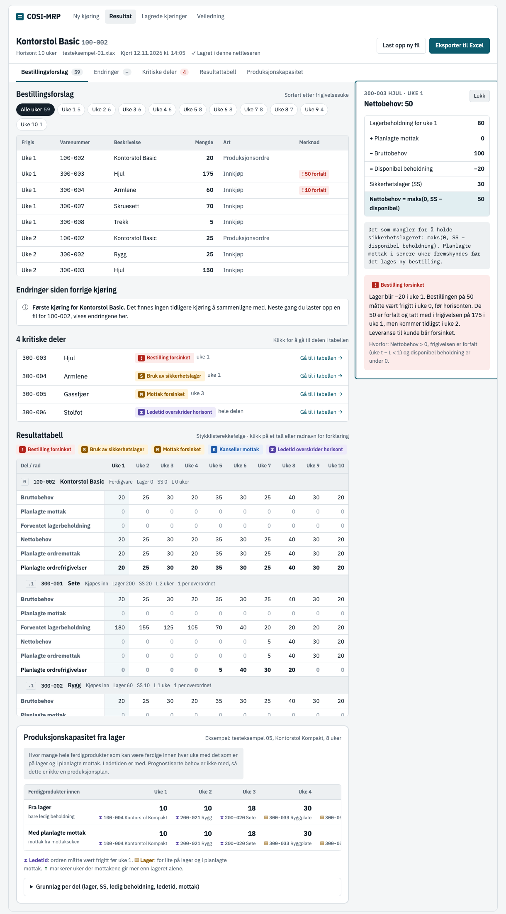

# Designforslag: brukergrensesnittet til COSI - MRP

> **Carmens designforslag – til diskusjon i gruppen.**
>
> Dette er ikke en godkjent løsning. Gruppen har ikke behandlet forslaget, og ingenting her endrer PRD-en, beregningen eller testdataene. Ved avvik gjelder PRD-en (`.docs/planning-artifacts/prds/prd-COSI - MRP-2026-10-19/prd.md`). Spørsmålene gruppen må ta stilling til, står i §7.

**Prototype:**

- Interaktiv prototype (privat til den deles): <https://claude.ai/artifact/Et77Y6Y3Jdwd2fqFEmnbfp>
- Statisk kopi i repoet, åpnes direkte i nettleseren: [`designforslag-2026-11-12-prototype.html`](designforslag-2026-11-12-prototype.html)
- Skjermbilde av resultatsiden: [`designforslag-2026-11-12-resultatside.png`](designforslag-2026-11-12-resultatside.png)

Prototypen bruker tallene fra fasiten til testeksempel 01 (resultattabell, eksepsjoner, bestillingsforslag), arket Sammenligning i fasit 03 og arket Kapasitet i fasit 05. Den er en skisse i HTML, ikke appens kode.



## Grunnlag

- PRD-en (`status: final`, oppdatert 2026-11-09), særlig §2.3 (brukerreiser), §4 og §5 (NFR-6, NFR-8, NFR-10)
- «Innspill til UX» i `addendum.md` i PRD-mappen
- Ordbanken (`.docs/ordbank.md`)
- Testeksempel 01, 03 og 05 med fasit (`testdata/`)
- Carmens skisse fra 2026-10-13 (`testeksempler/skisse-resultatside.md`), som er utdatert på noen punkter (se §7)

Sebastian har gjort research om brukergrensesnittet på `Sebastian/Branch` (`.docs/planning-artifacts/research/reports/Brukergrensesnitt for COSI MRP.md`, 2026-11-09). Den er ikke på `main` ennå. Forslaget her peker i samme retning på de fleste punkter: én arbeidsflate i fast rekkefølge, et ikke-modalt forklaringspanel og et eget kapasitetspanel. Forskjellene står i §7.

## 1. Hva PRD-en krever av grensesnittet

PRD-en gir tre tilstander: før opplasting, når filen har feil, og når kjøringen er ferdig. Nesten alt brukeren gjør, skjer i den siste. Rekkefølgen på resultatsiden er bestemt i §4.4: først bestillingsforslag, så kritiske deler, så resultattabellen.

| Visning | Innhold | Krav |
|---|---|---|
| Startside | Kort veiledning (fyll ut, last opp, les tabellen), nedlasting av malen og testeksempel 01, opplasting av én `.xlsx`, valg av beregning (bestillingsplan, produksjonskapasitet eller begge), lagrede kjøringer med sletting, beskjed når lokal lagring er blokkert | FR-1, FR-27, FR-30, FR-19, FR-21, NFR-10 |
| Valideringsfeil | Alle feil samlet: ark, rad eller celle, felt og årsak. Ingen beregning. Lagret kjøring urørt. Ny opplasting uten å laste siden på nytt | FR-2–FR-4, NFR-9 |
| Kjøringslinje | Ferdigproduktets navn og varenummer, horisont, filnavn, tidspunkt, lagringsstatus, «Last opp ny fil», «Eksporter til Excel» | FR-14, FR-22, FR-23 |
| Bestillingsforslag | Liste sortert etter frigivelsesuke: varenummer, beskrivelse, uke, mengde, innkjøp eller produksjonsordre, merke for forfalt mengde. Filter på én uke | FR-17 |
| Før/etter-sammenligning | Nye, endrede og fjernede bestillingsforslag, nye og borte eksepsjoner, nye og fjernede deler. Vises bare når det finnes en tidligere kjøring | FR-20 |
| Kritiske deler | Antall og liste med eksepsjonstyper. Klikk går til delen i tabellen | FR-13, FR-16 |
| Resultattabell | Seks rader per del, én kolonne per uke, i stykklisterekkefølge. Eksepsjoner markert med farge og symbol. Faste kolonner ved sidescroll | FR-14, FR-15, NFR-8 |
| Forklaringspanel | Åpnes ved klikk på rad eller celle, står til brukeren lukker det. Tallene bak resultatet, bidrag fra overordnede deler, forklaring av eksepsjonen. Mus, tastatur og berøring, ikke hover | FR-18 |
| Produksjonskapasitet | Eget panel med egen overskrift. To rader (fra lager, med planlagte mottak), begrensende deler med årsak, grunnlag per del | FR-30–FR-34 |
| Senere | Bestillingsregel og partistørrelse per del i tabellen og forklaringen | FR-24–FR-26 |

## 2. Sidestruktur og brukerflyt

Appen trenger bare to sider: en startside og en resultatside.

```text
Startside ──last opp──► kontroll ──feil──► Valideringsfeil (på startsiden)
                           │                    │
                           │                    └─ rett i Excel, last opp igjen
                           ▼
                     Resultatside
                     ├─ Kjøringslinje (alltid synlig)
                     ├─ Bestillingsforslag
                     ├─ Endringer siden forrige kjøring
                     ├─ Kritiske deler
                     ├─ Resultattabell  ◄──► Forklaringspanel (til høyre)
                     └─ Produksjonskapasitet (eget panel)
```

- **Startsiden** har veiledningen i tre steg, nedlasting av malen og testeksempel 01, valg av beregning (FR-30), opplasting og listen over lagrede kjøringer med «Slett» (FR-21). Valideringsfeilene vises her, rett under opplastingen, fordi brukeren skal rette i Excel og laste opp igjen.
- **Resultatsiden** er én side med en seksjonsmeny øverst. Den gjør det enkelt å hoppe mellom delene uten å miste konteksten. Den passer også kravet om at bestillingsplanen og kapasiteten står på samme side når begge er valgt (FR-34).
- **Rekkefølgen følger PRD-en §4.4.** Bestillingsforslagene står først. Før/etter-sammenligningen står rett etter, fordi PRD-en ikke sier hvor den skal stå, og fordi brukeren i UJ-3 bruker den til å kontrollere endringen. Seksjonsmenyen viser antall endringer, så brukeren ser med en gang om noe er endret uten at sammenligningen kommer før forslagene.
- **Hovedløkken** i UJ-2 og UJ-3 er: endre i Excel → last opp ny fil → se endringer → bestill eller ring leverandør → eksporter. Derfor står «Last opp ny fil» og «Eksporter til Excel» alltid synlige i kjøringslinjen.

## 3. Designretning: planleggerens arbeidsbenk

Verktøyet skal se ut som et presist arbeidsverktøy, ikke som et dashbord. Flatene er rolige og kjølige, tallene står tett og rett, og bare to ting får farge: det brukeren kan klikke på (petrol), og eksepsjonene. Det følger mot-målet SM-C3: tabellen skal ikke fylles med farger og symboler for å se informativ ut.

### Farger

| Rolle | Lys | Mørk | Brukes til |
|---|---|---|---|
| Bakgrunn | `#F4F6F7` | `#0E1317` | Siden |
| Flate | `#FFFFFF` | `#151C22` | Tabeller og paneler |
| Tekst | `#14202B` | `#E4E9ED` | All tekst |
| Petrol (aksent) | `#0D5C6E` | `#62B6C8` | Knapper, valgt celle, aktiv seksjon |
| Kritisk | `#B3261E` | `#FF8C82` | Bestilling forsinket, negative tall |
| Advarsel | `#8F5A00` | `#F0B74E` | Bruk av sikkerhetslager, Mottak forsinket |
| Info | `#1E5AA8` | `#8EB8F0` | Kanseller mottak |
| Horisont | `#5A48A6` | `#B9AEF2` | Ledetid overskrider horisont |

Lys modus er standard. Mørk modus finnes i prototypen, men er ikke et krav i v1.

### Typografi

- **IBM Plex Sans** til tekst og tabeller. Skriften er laget for industri og teknisk dokumentasjon og har tydelige tall.
- **IBM Plex Sans Condensed** til overskrifter, så de tar lite plass over tabellene.
- **IBM Plex Mono** til varenummer, så de skiller seg fra mengder.
- Alle tall har like brede sifre (`tabular-nums`) og er høyrejustert.

### Tabeller

- Radhøyde 32 px, tynne skillelinjer, ingen sebrastriper.
- Delens hode (nivå, varenummer, beskrivelse, type, lager, SS, ledetid, antall per overordnet del) og radnavnene står fast ved sidescroll (NFR-8).
- Nivået vises med innrykk og en liten nivåmerkelapp (`0`, `.1`, `..2`).
- Uke 1 har svak bakgrunn, fordi det er uka brukeren handler i.
- Planlagte ordrefrigivelser er fet, fordi det er tallene brukeren bestiller etter.
- Nuller er dempet, negative tall er røde og fete.

### Navigasjon

- Toppmeny for appen: Ny kjøring, Resultat, Lagrede kjøringer, Veiledning.
- Seksjonsmeny på resultatsiden med antall: Bestillingsforslag (59) · Endringer · Kritiske deler (4) · Resultattabell · Produksjonskapasitet.
- Ingen sidemeny, så tabellen får hele bredden.

## 4. Resultatsiden

### 4.1 Kjøringslinje

Øverst står ferdigproduktets navn og varenummer, horisonten, filnavnet, tidspunktet og om kjøringen er lagret i nettleseren. Er lokal lagring blokkert, står det her at kjøringen ikke blir lagret (NFR-10). Til høyre står «Last opp ny fil» og «Eksporter til Excel».

### 4.2 Bestillingsforslag

En tabell med kolonnene Frigis, Varenummer, Beskrivelse, Mengde, Art (Innkjøp eller Produksjonsordre) og Merknad. Forslag med forfalt mengde får en rød merkelapp med symbol og tekst, for eksempel «! 50 forfalt». Over listen står ett filter per uke med antall forslag, pluss «Alle uker». Testeksempel 01 gir 59 forslag, 5 av dem i uke 1. Listen har fast høyde og ruller inni seg selv.

### 4.3 Endringer siden forrige kjøring

Står rett etter bestillingsforslagene. Uten tidligere kjøring vises en kort melding: «Første kjøring for Kontorstol Basic. Det finnes ingen tidligere kjøring å sammenligne med.» Med tidligere kjøring vises en tabell med Endring, Del, Uke og Før → etter. Endringstypene har hver sin merkelapp: Endret mengde, Nytt forslag, Fjernet forslag, Ny eksepsjon, Eksepsjon borte, Ny del, Fjernet del. De første linjene vises, og resten ligger bak «Vis alle».

Eksempel fra arket Sammenligning i fasit 03 (02 → 03):

| Endring | Del | Uke | Før → etter |
|---|---|---|---|
| Endret mengde | 300-004 Hjul | 1 | 130 → 205 |
| Nytt forslag | 300-002 Skruesett M6 | 1 | 30 |
| Ny eksepsjon | 300-004 Hjul | 1 | Bruk av sikkerhetslager |
| Ny eksepsjon | 200-002 Rygg | 2 | Mottak forsinket |
| Eksepsjon borte | 200-002 Rygg | 3 | Mottak forsinket |

### 4.4 Kritiske deler

Overskriften er antallet, for eksempel «4 kritiske deler». Hver del står på én rad med varenummer, beskrivelse, eksepsjonstypene og uken, og «Gå til i tabellen». Et klikk ruller til delen i resultattabellen, markerer den kort og flytter tastaturfokuset dit (FR-16). Tabellen sorteres ikke om.

### 4.5 Resultattabell

Delene står i samme rekkefølge som i arket Stykkliste. En felles del står der den står første gang (FR-16). Hver del har et hode og de seks radene fra FR-14: Bruttobehov, Planlagte mottak, Forventet lagerbeholdning, Nettobehov, Planlagte ordremottak og Planlagte ordrefrigivelser. Hver celle og hvert radnavn er en knapp som åpner forklaringspanelet.

## 5. Eksepsjoner, forklaringer og produksjonskapasitet

### 5.1 Eksepsjoner

Hver av de fem typene har fast farge, et symbol og navnet fra ordbanken. Markeringen bruker aldri farge alene (FR-15, NFR-8).

| Eksepsjon | Symbol | Farge |
|---|---|---|
| Bestilling forsinket | `!` | Kritisk |
| Bruk av sikkerhetslager | `S` | Advarsel |
| Mottak forsinket | `M` | Advarsel |
| Kanseller mottak | `K` | Info |
| Ledetid overskrider horisont | `⧗` | Horisont |

- **I tabellen:** En kritisk del får en egen rad, «Eksepsjoner», øverst i delen. Symbolet står i uken eksepsjonen gjelder. Flere eksepsjoner i samme uke står side om side. Tallradene får ingen ekstra farge.
- **Uke «–»:** «Ledetid overskrider horisont» står som merkelapp i delens hode, ved navnet (FR-15).
- **Kritisk del:** Delens hode får «● Kritisk» i tekst.
- **Klikk på symbolet** åpner hele meldingen i forklaringspanelet.

### 5.2 Forklaringspanelet

Panelet står til høyre for tabellen og åpnes ved klikk eller Enter/mellomrom på en celle eller et radnavn. Det står til brukeren lukker det med «Lukk» eller Esc, og fokuset går da tilbake til cellen. Det åpnes ikke ved hover (FR-18). Den valgte cellen får en petrolramme. På smal skjerm blir panelet et ark nederst på skjermen.

Panelet viser:

1. Del, rad og uke, og verdien som overskrift (for eksempel «300-003 Hjul · uke 1 · Nettobehov: 50»).
2. Utregningen linje for linje med de faktiske tallene.
3. En kort forklaring av hva raden betyr.
4. Eksepsjonene i uken, med hele meldingen og en linje om hvorfor eksepsjonen slo til.

Eksempelet PRD-en krever i FR-18, 300-003 Hjul, uke 1:

| Linje | Verdi |
|---|---|
| Lagerbeholdning før uke 1 | 80 |
| + Planlagte mottak | 0 |
| − Bruttobehov | 100 |
| = Disponibel beholdning | −20 |
| Sikkerhetslager (SS) | 30 |
| **Nettobehov = maks(0, SS − disponibel)** | **50** |

Under står eksepsjonen «Bestilling forsinket» med meldingen fra fasiten.

For bruttobehov viser panelet hvilken overordnet del behovet kommer fra, frigivelsen og antallet per enhet. For en felles del står én linje per overordnet del (FR-18, FR-28). For planlagte ordrefrigivelser viser panelet uken ordren skal mottas, ledetiden og eventuell forfalt mengde. Et klikk på radnavnet gir forklaringen av hele raden.

### 5.3 Produksjonskapasitet

Kapasiteten står i et eget panel med kraftigere ramme og overskriften «Produksjonskapasitet fra lager», adskilt fra bestillingsplanen (FR-34). Rett under overskriften står det at kapasiteten tar med ledetid, men ikke prognostiserte behov, og at den ikke er en produksjonsplan.

- To rader, «Fra lager» og «Med planlagte mottak», med én kolonne per uke (FR-32). Tallet står stort.
- Under hvert tall står den begrensende delen med varenummer og årsak (FR-33): `⧗` for ledetid og `▤` for lager, med forklaring under tabellen. Årsaken vises med symbol og tekst, ikke farge alene.
- `↑` markerer uker der mottakene gir mer enn lageret alene.
- Grunnlaget per del (lager, SS, ledig beholdning, ledetid, planlagte mottak per uke) ligger i et utvidbart panel.

Eksempel fra fasit 05 (Kontorstol Kompakt, 8 uker):

| Ferdigprodukter innen | Uke 1 | Uke 2 | Uke 3 | Uke 4–6 | Uke 7–8 |
|---|---|---|---|---|---|
| Fra lager | 10 (⧗ 100-004) | 10 (⧗ 200-021) | 18 (⧗ 200-020) | 30 (▤ 300-033) | 30 (▤ 300-033) |
| Med planlagte mottak | 10 | 10 | 18 | 30 | 35 ↑ (▤ 300-032) |

## 6. Hva som synes med én gang, og hva som ligger bak et klikk

Regelen er: det brukeren må handle på, og det som viser om tallene kan stoles på, synes uten klikk. Det som forklarer hvorfor, ligger ett klikk unna, alltid på samme sted.

| Synlig med én gang | Bak et klikk eller i utvidbart panel | Ikke i v1 |
|---|---|---|
| Ferdigprodukt, horisont, filnavn og tidspunkt | Forklaring av hvert tall og hver rad | Forklaring ved hover (FR-18 forbyr det) |
| Om kjøringen er lagret, eller at lagring er blokkert | Hele eksepsjonsmeldingen med forfalt mengde og tidligste mottaksuke | Grafer over behov per uke (ikke besluttet, se addendum) |
| Bestillingsforslag med mengde, uke, art og forfalt mengde | Bidraget fra hver overordnet del til bruttobehovet | Egen ukevisning ved siden av listen (FR-17) |
| Antall endringer og de første linjene | Resten av endringslisten | Kritiske deler flyttet øverst i tabellen (FR-16) |
| Antall kritiske deler og eksepsjonstypene | Grunnlaget per del i kapasitetspanelet | Mobiltilpasset tabell (NFR-6) |
| Alle seks radene for alle deler, med eksepsjonssymboler | Veiledningen på startsiden etter første besøk | |
| Kapasiteten per uke og den begrensende delen | Lagrede kjøringer og sletting (startsiden) | |
| «Last opp ny fil» og «Eksporter til Excel» | | |

## 7. Spørsmål til gruppen

1. **Hvor skal eksepsjonen stå i tabellen?** Forslaget har en egen eksepsjonsrad øverst i hver kritiske del. Alternativet er å markere en av tallcellene, men da må vi velge hvilken rad hver type hører til, og tallene blir vanskeligere å lese.
2. **Skal bestillingsforslagene starte filtrert på uke 1?** PRD-en sier at listen viser alle forslag og kan filtreres. I UJ-2 filtrerer Kari på uke 1 med en gang. Forslaget viser alle, med uke 1 som første filter.
3. **Kompakt tabell?** En bryter som bare viser forventet lagerbeholdning og planlagte ordrefrigivelser. Alle seks radene er standard.
4. **Ordvalg.** Ordbanken sier «produksjonskapasitet», ikke «lagerkapasitet». Forslaget bruker overskriften «Produksjonskapasitet fra lager».
5. **Skissen fra 2026-10-13.** `testeksempler/skisse-resultatside.md` bruker «registrerte mottak» og en egen kolonne for uke 0. PRD-en har siden lagt forfalte frigivelser i uke 1. Skal skissen arkiveres?
6. **Kapasiteten i brukerreisene.** Åpent punkt fra 2026-11-09: ta kapasiteten inn i UJ-2, så den også kommer med i brukertesten (PRD §9 nr. 4).
7. **Forskjeller fra Sebastians research.** Researchen anbefaler en farget ramme rundt tabellen i stedet for grå flater med én aksent, og bare lys modus i v1. Forslaget her har grå flater og petrol, og mørk modus som ekstra. Researchen nevner også shadcn/ui som komponentbibliotek. Det avgjøres i arkitekturen.
8. **Nye UI-begreper i ordbanken.** Forslaget bruker kjøringslinje, seksjonsmeny, eksepsjonsrad og forklaringspanel. De legges inn i ordbanken først når gruppen har godkjent designet.

## Endringshistorikk

| Dato | Endring |
|---|---|
| 2026-11-12 | Første versjon. Før/etter-sammenligningen er flyttet etter bestillingsforslagene, så rekkefølgen følger PRD-en §4.4. |
